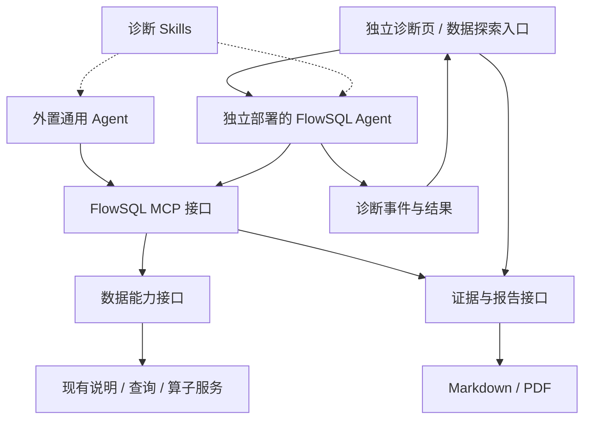

# 大模型与 Skills 交互式异常诊断分析报告

日期：2026-11-25

归档状态：上一轮讨论报告全文；技术建议尚未通过原型或模型效果评测，不代表已选型或已实现。

归档时仓库基线：`1c3e9ac`；报告中的现状来自当轮仓库核查，不代表重新执行产品验收。

后续规划：[交互式异常诊断 Epic](../../tasks/specs/epic-llm-skill-diagnosis.md)。

以下保留原报告正文，仅将本地文件链接转换为仓库相对路径。

---

我的建议是：**把这个 Feature 定义为“可由不同 Agent 驱动的诊断工作台”——FlowSQL 提供统一的数据、证据、图表和报告能力，外置通用 Agent 与内置专用 Agent 共用这些能力。内置 Agent 作为独立服务部署。**

这样，外置方案的投入可以直接复用于内置方案；表格、图表和报告也能获得统一的数据依据。

以下分析基于当前仓库和截至 **2026-11-25** 查阅的官方资料。框架能力经过文档核查，尚未开展模型效果或原型实测。

**现有项目基础比较完整，但当前 Backlog 尚未覆盖你提出的完整产品形态。**

当前 [Feature 定义](../../tasks/product_backlog.md) 主要描述 DNS 诊断、受控查询和有证据的解释。独立 Agent 部署、交互图表和诊断报告保存，需要补入新的交付目标。

仓库里可以复用的能力及缺口如下：

| 方面 | 当前基础 | 本 Feature 需要补充 |
|---|---|---|
| 数据理解 | 通道、算子、字段说明及 NPM 运行依据已经存在 | 转成 Agent 易于发现和调用的工具、资源及 Skills |
| 数据探索 | 独立服务、数据库与 DataFrame 来源、表格和多种图表 | 从探索进入诊断，携带当前范围；诊断结果可继续探索 |
| 图表 | 已有折线、饼图、柱状、直方图等 | 对话中连续生成多个证据图，并支持点击追问 |
| 查询控制 | 探索查询已有结果限额、期限和取消 | 面向 Agent 的授权范围、查询约束和证据记录 |
| 保存 | 已有部分数据快照和语义依据 | 诊断会话、证据、报告及 Markdown/PDF 导出 |

还有一个明确的接入问题：当前探索服务的来源发现会排除数据库视图，而 NPM 分析依赖 `history/latest/final` 等公开关系。因此，不能假定“已有探索功能”就等于“NPM 诊断结果已经可以直接绘图”。这一点需要在接入设计中处理。[源码依据](../../src/services/visualization/exploration_service.cpp)

---

**入口建议同时提供独立工作台和数据探索内的上下文入口，两者使用同一个诊断会话模型。**

| 入口 | 主要用途 | 建议行为 |
|---|---|---|
| 独立诊断页面 | 从问题出发开展调查 | 选择数据来源、时间窗、对象，提出问题；查看历史诊断和报告 |
| 数据探索页面 | 从已看到的异常继续分析 | 点击“诊断当前数据”或选中图表区域后追问 |
| 外置通用 Agent | 在用户已有工作环境中诊断 | 通过 MCP 使用 FlowSQL 数据和诊断产物能力 |

从探索页面进入时，应该携带明确的上下文：

- 当前数据来源及运行或快照身份。
- 时间窗、筛选条件、所选字段及聚合口径。
- 当前图表配置、计算结果引用和数据说明引用。
- 用户选中的时间段、系列或数据点。

例如，用户框选折线图的一段后问：“这段为什么升高？”Agent 应当拿到对应时间范围、指标含义和筛选条件。

建议探索页先打开侧边诊断面板，允许展开为完整工作台；完整工作台采用“对话 + 证据画布”，支持固定重要图表、查看数据和编排报告。进入诊断后，用户仍然可以返回原探索位置继续操作。

这些上下文需要通过接口传递，不能依靠读取页面文字或截图猜测。

---

**外置通用 Agent 的重点确实是 Prompt、MCP、Skills，但还必须包含诊断产物契约和效果评测。**

首先需要区分这几项的职责：

| 层次 | 解决的问题 | FlowSQL 应交付的内容 |
|---|---|---|
| Prompt | 本次诊断的目标、角色和输出要求 | 问题上下文、证据要求、诊断表达规则 |
| MCP | Agent 如何发现和调用数据能力 | 发现、描述、查询、任务状态、取消、保存产物等工具 |
| Skills | 某类问题应该怎样调查 | DNS 时延、失败响应、观察缺口等诊断方法 |
| 产物契约 | 结果怎样被其他界面和导出器使用 | 表格、图表、结论、证据、报告的结构化表达 |
| 评测集 | 怎样证明诊断可靠 | 固定数据、预期事实、应识别的证据缺口和错误归因 |

**Prompt 和 Skills 属于指导层，实际读写能力及权限必须由接口和执行服务落实。**

MCP 定义工具调用及结构化结果；Agent Skills 定义以 `SKILL.md` 为核心的可分发能力包，两者承担不同职责。安装 MCP 服务不会自动完成 Skills 的安装与加载，具体宿主仍需适配。[MCP 工具规范](https://modelcontextprotocol.io/specification/latest/server/tools)、[Agent Skills 规范](https://agentskills.io/specification)

一个 DNS Skill 应包含：

- 适用问题和必要输入。
- 应读取的数据说明与运行依据。
- 调查顺序、比较方法和可选分支。
- 成立条件、反证和停止条件。
- 推荐的表格、图表和结论结构。
- 必要的查询示例或可执行脚本。

数据字段含义继续从 FlowSQL 的说明接口取得，避免 Skills 再维护一套容易漂移的数据字典。

外置方案还有一个产品边界：**FlowSQL 可以保证工具和产物契约，外部宿主是否遵守完整调查流程、支持交互图表，需要分别验证。**

目前 MCP Apps 已允许工具提供交互式图表、表单和仪表盘，在宿主的隔离页面中呈现，但客户端支持情况不同。因此可以提供两种交付能力：

- 普通 MCP 客户端：结构化结果、图表预览、报告及工作台链接。
- 支持 MCP Apps 的客户端：直接在对话内展示交互表格和图表。

不能仅凭“支持 MCP”就承诺完整的内嵌图形体验。[MCP Apps 官方说明](https://modelcontextprotocol.io/extensions/apps/overview)

---

**内置自研 Agent 建议采用成熟运行时，自研诊断方法、状态和产品交互。**

这里存在三个独立选择：

1. 用户使用 FlowSQL 界面还是外部 Agent 界面。
2. Agent 运行在自己的服务中，还是供应商托管环境。
3. 模型使用云 API 还是本地推理服务。

所以，“内置”完全可以是 **FlowSQL 原生体验 + 独立部署的 Agent 服务 + 可配置的模型供应商**。Agent 独立部署也不自动意味着数据不会发送到云模型，模型部署位置要另外明确。

我调研的主要路线如下。表中的适用性判断是结合本项目需求作出的分析。

| 路线 | 已提供的能力 | 对本项目的判断 |
|---|---|---|
| **LangGraph + Deep Agents SDK** | 状态编排、持久化、流式输出、人工介入；进一步提供规划、Skills、上下文管理和子 Agent | **优先验证**。与持续调查、证据积累、追问和分支分析吻合 |
| **OpenAI Agents SDK** | Agent 循环、工具、MCP、交接、运行状态等；在自己的应用中运行 | 很有竞争力，尤其适合以 OpenAI 为主要模型供应商的部署 |
| **Claude Agent SDK** | Claude Code 的执行循环、上下文、Skills、MCP、会话、权限和子 Agent | 适合重视脚本执行和复杂自主调查、接受 Claude 生态依赖的方案 |
| **Pydantic AI / Harness** | 类型化工具和输出、多供应商、持久化、规划、Skills 及评测能力 | 强候选，尤其适合强调契约校验和 Python 工程集成的团队 |
| **Dify 等应用平台** | 自托管应用搭建和可视化配置 | 适合需要运营人员配置流程的场景；深度诊断画布仍需定制 |
| **直接使用模型 API 自建循环** | 自由度最高 | 需要自己承担状态、恢复、工具循环和上下文工程，当前缺少优先选择它的理由 |

官方依据：[LangGraph](https://docs.langchain.com/oss/python/langgraph/overview)、[Deep Agents](https://docs.langchain.com/oss/python/deepagents/overview)、[OpenAI Agents](https://developers.openai.com/api/docs/guides/agents)、[Claude Agent SDK](https://code.claude.com/docs/en/agent-sdk/overview)、[Pydantic AI](https://pydantic.dev/docs/ai/overview/)、[Dify 自托管](https://docs.dify.ai/en/self-host/deploy/quick-start/docker-compose)。

**当前推荐是：Python 独立诊断服务，以基于 LangGraph 的 Deep Agents SDK 作为主要运行时。**

推荐理由主要是需求匹配：诊断会不断形成假设、查询证据、遇到反证并调整调查方向，同时需要保持会话和调查状态。Deep Agents 提供这类运行基础，也支持不同具备工具调用能力的模型。[模型接入说明](https://docs.langchain.com/oss/python/deepagents/models)

工程上使用一个主要运行时即可。Deep Agents 已建立在 LangGraph 上，不需要再叠加另一套 Agent SDK 驱动同一调查循环。Pydantic 可以用于契约校验，这与另引入 Pydantic AI 运行时是两回事。

建议采用的诊断模式是：

> 明确问题和范围 → 读取数据说明 → 建立候选解释 → 获取证据 → 验证或排除 → 补充调查 → 形成结论和报告。

其中：

- **模型负责调查选择**：提出假设、选择工具、解释证据和决定下一步。
- **程序负责确定性执行**：权限校验、计算、状态记录、证据引用、图表校验和导出。
- **主 Agent 负责整体结论**；需要独立比较多个假设时，可调用专门的分析子 Agent。
- **数值、查询结果和引用由程序核对**；模型审查只能补充语义判断。

多 Agent 值得保留为能力候选，但是否启用应由评测证明。把一次简单查询固定拆成多个 Agent，会增加调用成本，也可能增加结论汇总误差。

复杂统计可以提供隔离的 Python 执行环境，处理经授权的结果快照，记录代码和输出。常规统计仍优先下推到 FlowSQL/数据库，避免搬运大量明细。

---

**独立部署应体现为清晰的服务边界，诊断产物也应能脱离某个 Agent 实现长期使用。**

建议的关系如下：

部署层面的建议是：

- Agent 有独立进程或容器、配置、模型凭证、健康检查和资源预算。
- Agent 重启或不可用时，已有数据探索和已保存报告仍可使用。
- 外置 Agent 可以使用 MCP 和报告能力，无需启动内置 Agent。
- 大量原始数据继续留在现有计算与数据通道中，Agent 接收有界结果及引用。
- 会话状态与证据持久化；重启后准确显示完成、失败和待继续状态。

LangGraph 的检查点机制有助于保存和恢复调查状态，但不能直接推导出外部查询或写操作“恰好执行一次”。有副作用的操作仍需关联任务身份、幂等处理及结果核对。[持久化机制](https://docs.langchain.com/oss/python/langgraph/persistence)

这也需要在正式规格中明确一个架构边界：新增的 Python Agent 是框架外的应用服务，与现有 Python Worker 职责分开；C++ 能力继续遵循现有 `.so` 插件框架。

接口标准化建议分层处理：

| 连接 | 建议 |
|---|---|
| Agent ↔ FlowSQL 工具 | MCP，远程部署采用 Streamable HTTP |
| 服务业务契约 | OpenAPI / JSON Schema，与 MCP 工具共用数据定义 |
| Skills 分发 | Agent Skills 格式，分别验证目标宿主的加载行为 |
| Agent ↔ 诊断页面 | 优先评估 AG-UI，传递消息、工具进度、状态和交互事件 |
| 外部对话中的图形界面 | MCP Apps，按宿主能力验收 |

AG-UI 解决 Agent 与前端的交互事件传输；MCP 解决工具与数据接入。两者不能互相替代，图表和报告的业务结构也仍需由 FlowSQL 明确定义。[AG-UI 官方说明](https://docs.ag-ui.com/introduction)

---

**表、图、文字应该共同组成诊断结果，而且每一项都能追溯到同一份证据。**

建议工作台至少支持以下内容：

| 内容 | 必需能力 |
|---|---|
| 数据表 | 分页、排序、筛选、单位、NULL 含义、范围说明、来源查看 |
| 图表 | 缩放、悬浮读数、系列选择、范围选择、查看对应数据 |
| 结论 | 区分已观察事实、候选原因、反证和待验证事项 |
| 过程提示 | 正在查询什么、已经发现什么、还缺哪些证据 |
| 证据卡片 | 查询条件、统计口径、执行时间、运行或快照依据 |

合适的图形由问题决定：

| 诊断问题 | 优先呈现 |
|---|---|
| 异常何时发生、持续多久 | 折线图，必要时叠加异常区间或参考线 |
| 哪些对象贡献最大 | 排序条形图 |
| 各类结果占比如何 | 少量类别用饼图；类别多时使用条形或堆叠图 |
| 时延是否出现长尾 | 直方图、箱线图 |
| 异常是否集中在特定对象和时间 | 热力图 |
| 两项指标是否共同变化 | 散点图，并明确相关性不代表因果 |

图表交互还应进入下一轮诊断。例如，用户点击一根代表某 DNS 服务端的柱子，再问“只分析它”，系统把对应对象和筛选范围作为结构化上下文传给 Agent。

图表技术可以这样选择：

| 技术 | 适合的位置 | 需要关注 |
|---|---|---|
| 现有 Graphic Walker | 人工探索、字段拖放和编辑 | 当前应用的会话及来源模型需要扩展 |
| **Vega-Lite** | Agent 生成声明式图表、多视图组合 | 限定数据引用和可执行表达范围 |
| ECharts | 深度定制的监控交互、标注和展示 | 要维护对应配置及导出路径 |

我倾向于以 **受约束的 Vega-Lite 图表定义作为诊断图表表达，复用现有 Graphic Walker 探索体验**。Vega-Lite 的 JSON 声明适合结构校验，也支持组合图和交互选择；现有 Graphic Walker 本身也基于这一图形体系。[Vega-Lite](https://vega.github.io/vega-lite/)、[Graphic Walker](https://github.com/Kanaries/graphic-walker)

图表引用服务端产生的数据集，由程序渲染。模型负责选择图形、字段和解释，避免让模型直接生成可任意执行的页面脚本。

另外，现有绘图接口支持的统计不等于完整诊断指标集。比如 P95、失败率和同比变化，若纳入诊断，就必须交付对应的可核验计算及分母、有效条件，不能只让模型写出这些数字。

---

**保存功能应以结构化诊断报告为中心，再生成 Markdown 和 PDF。**

如果只保存最后一段回答，后续很难判断结论来自哪批数据，也难以重建图表。

建议保留四类对象：

| 对象 | 核心内容 |
|---|---|
| 诊断上下文 | 问题、来源、时间范围、筛选、运行或快照引用 |
| 证据 | 查询及参数、结果快照、数据说明依据、完整性和采样状态 |
| 展示内容 | 表格、图表、结论，以及它们引用的证据 |
| 报告 | 标题、摘要、内容顺序、人工修改、保存时间和来源记录 |

其中最重要的是：**报告的表格和图表必须引用保存下来的结果，而不能打开报告时重新查询当前数据库。**

只保存 SQL 无法保证复现，因为源数据可能变化。可以保存支撑报告的聚合结果和必要明细，并记录采样、截断和查询时间；无需复制整库。当前数据库探索也没有跨图表一致快照保证，因此报告必须准确表达各结果的观测依据。[现有探索边界](../exploration.md)

导出建议如下：

- **Markdown**：导出正文、表格、证据说明和图表图片；完整离线交付采用 `.md + assets/` 打包。单独一个 Markdown 文件不能普遍保证图片可离线显示。
- **PDF**：从同一报告结构生成专门的打印页面，处理中文字体、分页、长表重复表头和图表清晰度，再用 Chromium/Playwright 导出。
- **在线报告**：保留交互图表；PDF 和 Markdown 保存相应静态图及数据说明。

Playwright 支持按打印样式生成 PDF；ECharts 等图形库也明确提供面向 Markdown/PDF 的 SVG 或图片渲染能力。[Playwright PDF](https://playwright.dev/docs/api/class-page#page-pdf)、[ECharts 服务端渲染](https://echarts.apache.org/handbook/en/how-to/cross-platform/server/)

用户应能编辑结论、添加备注、选择哪些图表进入报告。保存后的报告应固定内容；后续继续调查产生新的保存结果，并记录人工编辑与模型生成内容的来源。

这些诊断产物属于产品数据，需要自己的持久化存储，不能放进开发验收使用的 `evidence/` 目录。

---

**可靠性重点是把“数据事实、模型解释和执行权限”分别落实到可检查的行为。**

有几项与本 Feature 直接相关：

1. **读写能力需要分级。** 查询分析数据、保存诊断产物、创建分析结果、修改业务配置，属于不同权限。用户授权调查后，范围内的普通查询可以连续执行；业务修改需要对应授权。
2. **查询约束不能只写在 Prompt 中。** 需要在执行端限制对象、时间、资源和操作类型。FlowSQL 的 `SELECT … USING … INTO …` 可能触发执行与写出，不能仅凭 `SELECT` 前缀判断只读。
3. **工具返回的文字是数据。** 数据行、日志和用户补充说明不能获得修改系统指令或扩大权限的能力。
4. **图表和结论必须显示口径。** 全量、Top-N、采样、截断和空集必须可区分。
5. **诊断有停止标准。** 达到证据要求、缺少必要数据或耗尽预算时，输出当前发现和缺口，避免无限查询。

以 DNS 为例，`query_only` 表示观测到的事务状态，不能直接认定服务端超时；缺少响应可能与采集范围、截断或其他观察条件有关。`matched` 也不能替代对 RCODE 的判断。这类领域规则正适合由说明接口提供事实定义，由 Skills 指导调查。

结论应包含“哪些证据支持、哪些证据反对、还需要验证什么”。未经校准，不建议展示模型自行给出的“根因概率 95%”。

---

**完整能力应先确定，再用有代表性的场景验证技术选择。DNS 可以承担首条验收链路，但不能缩减你要求的产品能力。**

建议用同一套数据、工具和验收场景比较候选运行时，覆盖：

| 验证场景 | 必须观察到的结果 |
|---|---|
| 从探索页进入诊断 | 来源、筛选、时间范围及图表上下文准确传递 |
| DNS 异常调查 | 能读取说明、执行查询、形成表图和有依据的结论 |
| 证据不足或存在反证 | 明确保留不确定性，不强行归因 |
| 用户点击图表追问 | 新调查严格使用选中的对象和范围 |
| 保存后源数据变化 | 已保存报告和图表保持原内容 |
| 取消、断连及服务重启 | 查询状态准确，证据不丢失，不重复产生写入 |
| 外置 Agent 接入 | 共用同一工具和产物契约，验证 Skills 与图形宿主能力 |
| Markdown/PDF 导出 | 中文、表格、图片和证据引用完整可读 |

评测同时记录结论正确性、证据引用正确性、错误归因、查询次数、延迟和模型成本。契约测试可以使用确定性模拟，但真实模型诊断效果必须另外验证。

**我目前建议采纳的方向是：双入口、内外 Agent 共用能力、独立部署的专用 Agent、可交互的证据画布，以及基于固定结果生成的 Markdown/PDF 报告。** 技术上优先验证 Deep Agents/LangGraph，保留 OpenAI Agents SDK 和 Pydantic AI 作为重点对照。最终选择应由上述场景的实测结果决定。

本轮仅完成仓库核查和方案调研，未修改代码、Backlog 或正式规格。
