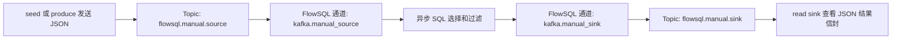

# Kafka 连接、结构化/原始包接入与发布

FlowSQL 提供可复用的 Kafka 连接配置与具名通道管理。连接负责 broker、TLS/SASL 与凭证生命周期；通道引用连接，并指定 `source`、`sink` 或 `both`、Topic、消费组和数据类别。

结构化 JSON source 可将外部日志、指标或业务记录转换为固定 Arrow Schema，供异步 SQL 分析使用；packet source 保留探针原始包和采集进度，供 NPM 实时分析。结构化 sink 发布逐行 JSON 结果信封；packet sink 将网卡采集的原始包与同次采集事实发布到集中端。连接验证只证明认证和元数据访问；读写权限在实际任务中检查。source 只能用于 FROM、sink 只能用于 INTO，角色不符返回 `KAFKA_ROLE_MISMATCH`。

## Docker 手动测试环境

本节是从首次启动到重复测试的操作教程，适用于 **WSL/Linux 中用 `./start.sh` 启动 FlowSQL，
用 Docker 运行 Kafka** 的开发环境。先按 Web 步骤完成一次 source → SQL → sink，再按需要使用等价 API。

阅读入口：[启动环境](#manual-start) · [连接配置](#manual-connection) · [source 表单](#manual-source) ·
[sink 表单](#manual-sink) · [执行 SQL](#manual-sql) · [供数与结果](#manual-data) ·
[重复测试](#manual-replay) · [停止与恢复](#manual-stop) · [常见问题](#manual-faq) · [API 操作](#manual-api)。



先记住以下四类名称，它们各自承担不同的职责：

| 对象 | 本教程使用的值 | 用途 |
| --- | --- | --- |
| 连接配置名称 | `manual` | 保存地址和认证配置，两个通道共用。 |
| FlowSQL 通道名称 | `manual_source` / `manual_sink` | SQL 分别引用 `kafka.manual_source` / `kafka.manual_sink`。 |
| Kafka Topic | `flowsql.manual.source` / `flowsql.manual.sink` | broker 中实际存放输入消息和输出消息的位置，由脚本创建。 |
| Kafka 消费组 | `flowsql_manual` | 保存 source 的消费进度，首次消费时建立，无需提前创建；sink 不填。 |

如果你已经创建了名为 `manual` 的 source 通道，可以继续使用，将下文 SQL 中的
`FROM kafka.manual_source` 换成 `FROM kafka.manual`。连接配置和通道同名允许；编辑已有通道时名称只读，
不必为了改名删除重建。本文后续统一使用 `manual_source`。

<a id="manual-start"></a>

### 1. 启动 Kafka 与 FlowSQL

需要 Docker Engine、Docker Compose v2、Python 3，以及已经编译好的 FlowSQL。打开 WSL/Linux 终端，
进入仓库根目录；本机路径为 `/mnt/d/working/flowsql`，大小写须一致。以下脚本用 Bash 执行，不直接粘贴到 PowerShell。

终端 A 启动 FlowSQL；如果服务已经运行，复用现有进程即可：

```bash
cd /mnt/d/working/flowsql
./start.sh
```

保持终端 A 运行，在浏览器打开 `http://localhost:8081`。如果缺少构建产物，先按
[README 编译步骤](../README.md#编译) 完成构建。默认 Kafka 配置和主密钥首次自动生成，通常不需手工准备。

终端 B 启动 Kafka 并检查状态：

```bash
cd /mnt/d/working/flowsql
./tools/kafka-manual.sh up
./tools/kafka-manual.sh status
```

预期容器 `flowsql-kafka-manual-manual-kafka-1` 为 `healthy`，输出中存在
`flowsql.manual.source` 和 `flowsql.manual.sink`，两者都是单分区、单副本。
`up` 可以重复执行，等待 broker 就绪并幂等创建 Topic；它不会自动启动 FlowSQL，也不会代你保存连接和通道。

此环境使用官方 Kafka 4.1.0 KRaft 单节点，镜像固定版本与摘要，首次按需拉取，不需宿主机安装 Kafka 或 Java。
PLAINTEXT 无账号密码，宿主端口只绑定回环地址；数据位于独立 Docker 卷，适合本地手测。

| FlowSQL 运行方式 | bootstrap_servers | 连接条件 |
| --- | --- | --- |
| 原生 `./start.sh`、single/multi 或直接进程 | `127.0.0.1:19092` | 与 Docker 发布端口位于同一开发主机 |
| Docker FlowSQL | `manual-kafka:9092` | Scheduler 容器加入 `flowsql-kafka-manual` 网络 |

本文原生流程使用 `127.0.0.1:19092`。若 FlowSQL 也在 Docker 中，broker 启动后对实际 Scheduler 容器执行
`docker network connect flowsql-kafka-manual 容器名`，连接地址改为 `manual-kafka:9092`；新建容器可使用
`--network flowsql-kafka-manual`。重新创建 Scheduler 容器后需重新加入网络。
broker Compose 为 [`config/docker-compose-kafka-manual.yml`](../config/docker-compose-kafka-manual.yml)。

<a id="manual-connection"></a>

### 2. 在 Web 创建连接配置 manual

进入“通道管理 → Kafka 通道”，点击“新建连接配置”，按下表填写：

| 页面字段 | 填写值 |
| --- | --- |
| 名称 | `manual` |
| Bootstrap servers | `127.0.0.1:19092`，不加 `http://`。 |
| 安全协议 | `PLAINTEXT` |

PLAINTEXT 不填写用户名、密码、TLS 或 SASL 配置。点击“验证草稿”检查连接，随后点击“保存连接”。
如果已经保存过 `manual`，在“连接配置”页签核对并复用，不要反复点击新建。

“连接验证通过”表示网络、认证和元数据检查成功；实际读取和写入由后面的 SQL 验证。
在“新建 Kafka 通道”中也可以点击“就地新建连接”，效果相同。

<a id="manual-source"></a>

### 3. 配置 source：读取 JSON 样例

点击“新建 Kafka 通道”，逐项填写输入通道：

| 页面字段 | 填写值 |
| --- | --- |
| 通道名称 | `manual_source` |
| 连接配置 | 在下拉列表中选中已经保存的 `manual`。 |
| 角色 | `source` |
| Topic | `flowsql.manual.source` |
| 消费组 | `flowsql_manual` |
| 数据类别 | `结构化数据` |
| 结构化接入 | **`配置 JSON 字段`**，不能保留“暂不配置”。 |
| 实体名称 | `metrics` |

连接配置下拉框支持搜索，输入 `manual` 后仍需选中对应选项；输入框中显示的搜索文字不代表连接已保存。
如果已有通道显示 source“待配置”，直接点击“编辑”补齐 JSON 字段。

展开“配置 JSON 字段”后，页面默认带一个 `message` 字段。将它改成下面的第一行 `host`，
再点击两次“新增字段”，按顺序配置全部三行；不要额外保留 `/message`，样例中没有这个字段。

| 页面中的输出列名 | JSON 路径 | 字段类型 | 允许空值 | 单位 |
| --- | --- | --- | --- | --- |
| `host` | `/host` | `utf8` | `必须存在且非 null` | 留空 |
| `time_ms` | `/time` | `int64` | `必须存在且非 null` | `unix_ms` |
| `value` | `/value` | `float64` | `必须存在且非 null` | 留空 |

这里 `/time` 是原始 JSON 中的字段，`time_ms` 是 SQL 使用的输出列名。路径必须带 `/`，时间值必须是整数，
不能填写日期字符串。三条样例的格式类似下面这样，实际 `seed` 使用发送时的 Unix 毫秒时间：

```json
{"host":"api-1","time":1800000000000,"value":1024.0}
```

继续填写 source 参数：

| 页面字段 | 填写值 | 作用 |
| --- | --- | --- |
| 无有效位点 | `从最早开始` | 该组没有有效已提交位点时，从最早保留的消息开始。 |
| 确认策略 | `当前批次处理及结果投递成功后确认` | 当前输出成功后确认进度。 |
| 批次最多行数 | `3` | 每批最多三行，便于观察本次样例。 |
| 单消息字节上限 | `1048576` | 单条消息最多 1 MiB。 |

点击“验证草稿”，再点击“保存通道”。列表中的“数据能力”预期显示 **source：已就绪**。
验证 Topic 存在不会消费消息；保存成功但显示“待配置”，仍需要补齐上述字段才能用于 SQL。

<a id="manual-sink"></a>

### 4. 配置 sink：发布 SQL 结果

再次点击“新建 Kafka 通道”，本次创建输出端：

| 页面字段 | 填写值 |
| --- | --- |
| 通道名称 | `manual_sink` |
| 连接配置 | `manual` |
| 角色 | `sink` |
| Topic | `flowsql.manual.sink` |
| 数据类别 | `结构化数据` |
| 结果发布 | **`配置 JSON 结果信封`** |
| 发布实体 | `metrics` |
| Schema 版本 | `1` |
| 记录语义 | `event 独立事件` |
| 业务 key 列 | 留空 |
| 消息字节上限 | `1048576` |
| 队列条数上限 | `1024` |
| 队列字节上限 | `8388608` |
| 确认预算毫秒 | `10000` |

sink 不显示消费组，也不需要 JSON 路径映射；它按照 SQL 选出的列生成结果信封。
本教程的样例没有业务 revision，选择 event 即可。点击“验证草稿”和“保存通道”，预期显示 **sink：已就绪**。

至此，连接配置列表中有 `manual`，通道列表中有 `manual_source` 和 `manual_sink`，两者分别使用不同 Topic。

<a id="manual-sql"></a>

### 5. 在 SQL 工作台启动任务

进入左侧“SQL 工作台”，粘贴下面的 SQL：

```sql
SELECT host, time_ms, value
FROM kafka.manual_source
WHERE value > 0
INTO kafka.manual_sink;
```

选择“异步”，点击一次“执行”，记下返回的任务 ID。任务进入 running 后，会持续等待 source 消息。
没有新消息时保持 running 是正常现象；不要因此反复点击执行。Kafka source 没有 EOF，读完当前消息不会自行完成。

该 SQL 读取三列、保留 value 大于 0 的记录，然后发布到 sink。它的结果在 Kafka 中，
不是自动生成一个可在网页展开的数据表；下一步用 `read sink` 检查。
第一次使用新消费组时，也可能立即处理 source Topic 中已有的历史样例。

<a id="manual-data"></a>

### 6. 发送数据并确认 source 与 sink

先在终端 C 进入仓库并持续查看 sink：

```bash
cd /mnt/d/working/flowsql
./tools/kafka-manual.sh read sink
```

此命令先打印 sink 中已有的消息，然后等待新消息。让终端 C 保持运行，在终端 B 发送样例：

```bash
./tools/kafka-manual.sh seed
```

每次 seed 追加三条，host 依次为 `api-1`、`api-2`、`api-3`，value 分别为 1024.0、2048.0、4096.0，
time 为本次发送时的整数毫秒。SQL 已运行且 source 配置正确时，终端 C 应出现对应的三个新增信封。

若要把这轮与旧结果清楚地区分，可以追加一条带自定义标记的数据，替换 host 中的后缀：

```bash
printf '%s\n' '{"host":"manual-check-001","time":1800000000000,"value":42.0}' | ./tools/kafka-manual.sh produce
```

在终端 C 新输出中查找 `data.host` 为 `manual-check-001` 的记录。下方仅摘出完整信封中用于观察的字段，
实际消息还包含 publication_id、Schema、Schema 指纹和记录身份等信息：

```json
{
  "envelope_version": 1,
  "entity": "metrics",
  "record_kind": "event",
  "task_id": "本次运行的任务标识",
  "data": {"host":"manual-check-001","time_ms":"1800000000000","value":42.0}
}
```

`time_ms` 作为 int64 在信封中编码为十进制字符串，这是无损编码。value 保持 JSON 数值。
信封 task_id 是写入端使用的运行时标识，可能与工作台返回的公共任务 ID 不同；可用于区分不同运行的结果。
`data.host` 的自定义标记是判断这轮新增消息最直观的方法。

以下命令适合只查看少量已有消息：

```bash
./tools/kafka-manual.sh read source 3
./tools/kafka-manual.sh read sink 3
```

它们读取的是分区 0 最早保留的三条消息，**不是最近三条**，也不证明它们来自刚启动的任务。
省略条数会继续等待，Ctrl-C 退出查看；指定条数时空闲等待预算为 15 秒，数量不足非零退出。
查看命令不提交 source 消费组的位点，Ctrl-C 结束查看也不会停止 SQL 任务。

<a id="manual-replay"></a>

### 7. 重复测试、续读与从头重放

| 你想做什么 | 操作 | 预期行为 |
| --- | --- | --- |
| 任务仍在运行，继续供数 | 再执行 `seed` 或 `produce`。 | 同一个 SQL 处理新增消息，sink 继续追加。 |
| 停止后继续测试 | 同一个 source 再执行原 SQL，然后发送新消息。 | `flowsql_manual` 从上次成功确认的位置续读。 |
| 重新处理历史消息 | 停止原任务，编辑 source，把消费组改成未用过的名称，例如 `flowsql_manual_replay_001`，保留“从最早开始”，再运行 SQL。 | 新组从当前仍被保留的最早消息开始；旧 sink 输出保留，并新增重放结果。 |
| 多轮都从头分析且不保留新进度 | 使用专用的新消费组，并将“确认策略”设为“不提交位点”。 | 本轮不提交新位点；下次仍依据这个组原来已有的位点或无位点策略打开。 |

“从最早开始”只在没有有效已提交位点时生效，不能覆盖同一组已经提交的进度。
把确认策略改成“不提交位点”也不会删除该组的旧位点；要从头读，应配合一个从未使用的新组。
不要在同一个手测组中同时运行多个消费任务，否则可能分担消息或发生重平衡，影响观察。

连接或通道显示“使用中”时先停止占用任务或等待连接验证结束，再编辑。重放可能产生重复结果，
输入位点与输出没有端到端 Exactly-once 事务保证；本教程不通过清空 Topic 或重置卷来重复测试。

<a id="manual-stop"></a>

### 8. 停止任务与恢复环境

按以下顺序结束本轮操作：

1. 在“SQL 工作台”的任务列表中找到本次任务，点击当前页面的“**取消**”按钮，等待进入
   stopped、cancelled、completed、failed 或 timeout 等终态。该按钮会按任务类型调用对应停止/取消操作。
2. 点击“查看结果”检查任务状态和错误。当前页面展示基本结果；完整发布计数通过下方查询命令读取
   `result.publication`。正常收尾时 `confirmed_rows` 应与本任务实际发布条数一致，包含本次处理的历史消息；
   `not_sent_rows`、`unknown_rows` 为 0。若失败或数量不符，先核对错误和部分投递情况，再决定是否重放。
3. 在终端 C 按 Ctrl-C 退出 sink 查看。
4. 需要停止 broker 时，在终端 B 执行 `down`。需要停止本轮自行启动的 FlowSQL 时，在终端 A 按 Ctrl-C。

在终端 B 查询已结束任务的完整结果，替换为工作台返回的公共任务 ID：

```bash
TASK_ID='替换成工作台中的任务 ID'
curl --fail-with-body -sS http://127.0.0.1:8081/api/tasks/result \
  -H 'Content-Type: application/json' -d "{\"task_id\":\"$TASK_ID\"}"
```

运行中的公共结果摘要可能尚未更新，不能仅凭当时 rows=0 判断消息没有发出；以实际 sink 消息和终态报告核对。
例如本任务只处理了三条 seed 样例和一条自定义标记时，`confirmed_rows` 应为 4。
完成核对后停止或恢复 broker：

```bash
./tools/kafka-manual.sh down
# 下次恢复 broker
./tools/kafka-manual.sh up
./tools/kafka-manual.sh status
```

`down` 停止 broker 并保留容器、网络与持久卷。`up` 恢复后复用仍保留的 Topic 消息和消费位点，
不会自动清空数据；消息仍受 Kafka 保留策略约束。FlowSQL 的连接/通道定义则保存在自身的 Kafka 状态目录，
重启后复用，但正在运行的 SQL 不会因 broker 恢复而自动重新提交。
broker 数据卷为 `flowsql-kafka-manual_kafka-data`，容器重启策略为 `unless-stopped`。

<a id="manual-faq"></a>

### 9. 常见问题与命令速查

| 现象 | 检查与处理 |
| --- | --- |
| Kafka 管理服务暂不可用 | 先看 FlowSQL 启动日志，确认运行的是已构建的新版本且加载了 Kafka 插件；broker 离线本身不会阻止管理页打开。原生重启服务后重试，Docker 需使用包含该插件的新镜像。 |
| 连接验证失败 | 执行 `status` / `logs`；原生用 `127.0.0.1:19092`，容器内用同网络的 `manual-kafka:9092`，协议为 PLAINTEXT。 |
| source“待配置” | 把“结构化接入”设为“配置 JSON 字段”，替换默认 message 字段，保存后确认 source“已就绪”。 |
| sink“待配置” | 把“结果发布”设为“配置 JSON 结果信封”，补齐发布实体、版本和 event 语义。 |
| 名称或字段校验失败 | 连接/通道名称以小写字母开头，最多 64 个小写字母、数字、下划线或短横线；在列表中选中已保存的连接；检查字段名和 JSON 路径。 |
| Topic 不存在 | 执行 `up`，再用 `status` 核对 Topic；必须精确填写 `flowsql.manual.source` 或 `flowsql.manual.sink`，broker 禁止自动建 Topic。 |
| SQL 一直 running | source 持续等待是正常现象；查看 sink 并追加带标记的新消息，结束时用任务列表“取消”。 |
| source 有消息但没有新输出 | 检查任务错误、source/sink“已就绪”、SQL 通道名称、WHERE 条件和已提交位点；同组可能已经读过，先追加标记消息。 |
| SQL 提示需要异步 | 在 SQL 工作台选择“异步”，通过 API 则传 `mode: "async"`。 |
| read sink 一直显示旧内容 | 它从最早消息开始；保持持续查看，再发送唯一 host 标记，观察新增信封。 |
| 再次运行 SQL 没有重放 | 同组从成功位点续读，按上一节换新消费组；不要删除数据卷。 |
| 无法编辑/删除，显示使用中 | 停止占用该通道的任务，等待验证结束，再刷新列表。 |
| 任务失败或 Web 请求超时 | 先查看任务列表、状态和启动日志，核对是否已有部分结果；确认后再重试，避免重复提交和重复发布。 |
| read 指定条数后非零退出 | 该 Topic 在等待预算内不足所需条数，或 broker 不可达；查看命令输出并核对实际条数。 |

| 命令 | 用途 |
| --- | --- |
| `./tools/kafka-manual.sh up` | 启动/恢复 broker，幂等准备 Topic。 |
| `./tools/kafka-manual.sh status` | 查看容器和 source/sink Topic。 |
| `./tools/kafka-manual.sh seed` | 追加三条固定字段的样例，time 随发送时间变化。 |
| `./tools/kafka-manual.sh produce` | 从标准输入逐行发送 JSON；交互输入按 Ctrl-D 结束。 |
| `./tools/kafka-manual.sh read source 3` | 从头查看 source 的三条已有消息。 |
| `./tools/kafka-manual.sh read sink` | 从头查看并持续等待 sink 消息，Ctrl-C 退出。 |
| `./tools/kafka-manual.sh logs` | 查看最近 100 行 broker 日志。 |
| `./tools/kafka-manual.sh down` | 停止 broker，保留数据。 |
| `./tools/kafka-manual.sh help` | 查看脚本帮助。 |

<a id="manual-api"></a>

### 10. 等价 API 操作

本节可替代 Web 创建和提交步骤。**二选一即可**，不要在 Web 保存同名配置后重复执行 add；
已有定义可在 Web 复用或编辑。假定端口为默认 8081，且服务使用原生方式运行：

```bash
API=http://127.0.0.1:8081
curl --fail-with-body -sS "$API/api/channels/kafka/connections/add" \
  -H 'Content-Type: application/json' -d '{
    "name":"manual","bootstrap_servers":["127.0.0.1:19092"],"security_protocol":"PLAINTEXT"
  }'

curl --fail-with-body -sS "$API/api/channels/kafka/channels/add" \
  -H 'Content-Type: application/json' -d '{
    "name":"manual_source","connection_name":"manual","role":"source",
    "topic":"flowsql.manual.source","consumer_group":"flowsql_manual",
    "payload_kind":"structured","payload_options":{"source":{
      "encoding":"json","entity":"metrics","offset_reset":"earliest",
      "commit_policy":"after_success","max_batch_rows":3,"max_message_bytes":1048576,
      "fields":[
        {"name":"host","path":"/host","type":"utf8","nullable":false},
        {"name":"time_ms","path":"/time","type":"int64","nullable":false,"unit":"unix_ms"},
        {"name":"value","path":"/value","type":"float64","nullable":false}
      ]
    }}
  }'

curl --fail-with-body -sS "$API/api/channels/kafka/channels/add" \
  -H 'Content-Type: application/json' -d '{
    "name":"manual_sink","connection_name":"manual","role":"sink",
    "topic":"flowsql.manual.sink","payload_kind":"structured",
    "payload_options":{"sink":{
      "encoding":"json","entity":"metrics","schema_version":1,"record_kind":"event",
      "key_fields":[],"max_message_bytes":1048576,"queue_max_messages":1024,
      "queue_max_bytes":8388608,"delivery_timeout_ms":10000
    }}
  }'

curl --fail-with-body -sS "$API/api/tasks/batch/execute" \
  -H 'Content-Type: application/json' -d '{
    "sql_text":"SELECT host, time_ms, value FROM kafka.manual_source WHERE value > 0 INTO kafka.manual_sink",
    "mode":"async"
  }'
```

前三个请求保存连接和两个通道，第四个请求提交任务。成功提交会返回 task_id，不代表任务已处理完数据。
按第 6 节发送消息并查看 sink。然后在同一终端中记录返回的公共任务 ID，再查询、停止和查询最终报告：

```bash
TASK_ID='替换成提交返回的 task_id'
curl --fail-with-body -sS "$API/api/tasks/result" \
  -H 'Content-Type: application/json' -d "{\"task_id\":\"$TASK_ID\"}"
curl --fail-with-body -sS "$API/api/tasks/cancel" \
  -H 'Content-Type: application/json' -d "{\"task_id\":\"$TASK_ID\"}"
curl --fail-with-body -sS "$API/api/tasks/result" \
  -H 'Content-Type: application/json' -d "{\"task_id\":\"$TASK_ID\"}"
```

本教程通过 batch/execute 异步提交，停止使用 tasks/cancel。停止后如果仍返回 running/stopping，稍后再次查询，
直到终态再核对 `result.publication`。不要用原始 SQL 或信封里的运行时标识代替公共 task_id。
若使用 Docker FlowSQL，连接请求中的 bootstrap_servers 改为 `manual-kafka:9092` 并保证网络已连接。

## 原生安装与启用

当前验收平台为 Ubuntu 24.04、Linux x86_64。固定客户端为 librdkafka 2.16.0，采用私有 PIC 静态链接；OpenSSL、libcurl、Cyrus SASL 与 MIT Kerberos 使用系统共享库。开发依赖和共享缓存由 `thirdparts/librdkafka/` 管理。

```bash
sudo apt-get install libssl-dev libcurl4-openssl-dev libsasl2-dev \
  libsasl2-modules-gssapi-mit libkrb5-dev krb5-user zlib1g-dev liblz4-dev libzstd-dev
cmake -B build src
cmake --build build -j4
```

缓存位于 Git 主工作区的 `.thirdparts_prefix/librdkafka` 与 `.thirdparts_installed/librdkafka`。指纹覆盖源码校验、私有 GSSAPI 补丁、依赖清单、构建脚本、平台、编译器及系统组件版本；匹配才复用，不同 worktree 对同一指纹的编译通过文件锁串行。`-DFLOWSQL_KAFKA_OFFLINE=ON` 禁止下载，必须有匹配安装缓存或已校验的源码包。源码校验和必需特性检查失败均终止，认证不降级。

运行环境需要 `libssl3t64`、`libcurl4t64`、`libsasl2-2`、`libsasl2-modules-gssapi-mit`、`libgssapi-krb5-2`、`libkrb5-3`、`krb5-user`、`ca-certificates`、`zlib1g`、`liblz4-1`、`libzstd1`，以及已有插件的运行包。检查共享库不能替代 SASL 插件、票据工具和实际认证检查。

### 默认启动与持久化

`./start.sh`、原生 `deploy-single.yaml` / `deploy-multi.yaml` 和基础 Docker Compose 均默认加载 Kafka 插件。
无需先准备 Provider 配置或密钥；首次启动自动初始化，之后复用。broker 尚未配置或离线不影响打开管理页、
保存连接及通道；连接验证和实际读写仍单独检查网络与认证。

原生默认状态根目录按以下顺序确定，与当前工作目录、构建目录无关：

1. `FLOWSQL_KAFKA_STATE_DIR` 指定的绝对路径。
2. 已设置 `XDG_STATE_HOME` 时使用 `$XDG_STATE_HOME/flowsql/kafka`。
3. 否则使用 `$HOME/.local/state/flowsql/kafka`。

根目录内固定保存：

| 文件 | 用途 |
| --- | --- |
| `config/kafka/provider.json` | Provider 配置，记录数据库、密钥和运行目录的绝对路径；只在首次缺失时创建。 |
| `secrets/kafka-master.key` | 首次随机生成的 32 字节二进制主密钥，后续启动不替换。 |
| `meta/kafka.db` | 已保存的连接、通道及加密凭证。 |
| `runtime/kafka/` | 私有认证会话临时文件。 |

例如在同一个终端指定 `export FLOWSQL_KAFKA_STATE_DIR=/srv/flowsql/kafka` 后，各原生入口均使用该位置。
目录需由运行用户拥有且支持 Linux 私有权限，默认目录为 `0700`、密钥及配置为 `0600`；WSL 应使用 Linux
文件系统，不能把始终呈现宽松权限的 Windows 挂载目录作为秘密存储。不同实例使用不同的状态根目录；
同一默认状态目录只允许一个 Provider 进程持有，避免不同启动方式同时修改同一数据库。

请将配置、数据库和原密钥一起持久化、备份。已有数据库缺少配置或密钥、密钥损坏或不匹配时明确启动失败，
不会重新生成替代密钥或切换到空数据库。清理 `build/` 不会删除默认状态。需要额外证书或秘密别名时，修改
已生成配置中的 `files` / `environments` 并重启，原文件不会在下次启动时被覆盖。

直接以插件参数启动时使用 `libflowsql_kafka.so:{}`；JSON 空对象明确选择默认部署，避免接收进程级的端口参数。
未提供任何插件参数也使用默认部署。已有显式配置的部署继续使用 `config_file=/absolute/path/provider.json`，
或完整 JSON 参数；显式配置缺失或无效时直接失败，不回退到默认状态。

### 显式部署配置

需要自行管理密钥、路径或只读挂载时，仍可使用以下方式。从 `build/output` 运行时，先准备部署方自己的密钥与目录：

```bash
mkdir -p meta secrets runtime/kafka config/kafka
chmod 700 secrets runtime/kafka
openssl rand -out secrets/kafka-master.key 32
chmod 600 secrets/kafka-master.key
cp ../../config/kafka/provider.example.json config/kafka/provider.json
```

首次部署才生成密钥，已存在数据库必须继续使用原密钥；更换或丢失密钥会使加密凭证无法恢复。将密钥备份到部署方的秘密管理系统，不放入 Git、镜像或 SQLite。连接定义、通道和加密凭证在同一 SQLite 事务中保存，数据库目录必须持久化。

Provider 配置文件示例：

```json
{
  "db_path": "./meta/kafka.db",
  "master_key_file": "./secrets/kafka-master.key",
  "runtime_directory": "./runtime/kafka",
  "files": {
    "corp_ca": "./secrets/ca.pem",
    "client_certificate": "./secrets/client.pem",
    "client_key": "./secrets/client.key",
    "service_keytab": "./secrets/service.keytab"
  },
  "environments": {
    "broker_password": "FLOWSQL_KAFKA_PASSWORD"
  }
}
```

路径由部署方控制，均相对于服务工作目录；Web 只选择 `file:corp_ca`、`env:broker_password` 等别名，不接受任意路径、JAAS、客户端参数或 shell 命令。不要给多个进程配置同一个数据库；同一 Scheduler Provider 是唯一配置真相。

在 Scheduler 插件列表加入：

```yaml
- name: libflowsql_kafka.so
  option: "config_file=config/kafka/provider.json"
```

原生模板已使用 `option: '{}'` 启用默认部署；采用显式配置时将其替换为上述 `config_file=`。
所有插件按 Option、Load、Start 三个批次加载。`config_file=` 也可用于命令行插件参数，避免 JSON 中的逗号被插件列表分隔器拆开。主密钥或数据库无法加载时启动失败；单个 broker 离线不会阻止合法定义保存。

## Docker 挂载

仓库 Dockerfile 安装相同的认证运行组件，并携带 `share/kafka/dependencies.json`、`build-info.json` 与 `LICENSES.txt`；源码、开发包和缓存留在构建环境。构建前完成原生全量编译和前端构建。

基础 `docker compose up -d` 已启用 Kafka 管理，无需 Kafka 专用覆盖文件。Scheduler 使用
`FLOWSQL_KAFKA_STATE_DIR=/opt/flowsql/kafka-state`，将整个状态根目录保存在 `kafka-state` 命名卷中，
重建容器后配置、密钥和通道定义继续复用。镜像不包含部署密钥。直接 `docker run` 时同样需把
`/opt/flowsql/kafka-state` 挂到持久卷；显式选择其他根目录时同步调整挂载。

需要自行提供只读 Provider 配置及密钥时，可参考
[`provider.docker.example.json`](../config/kafka/provider.docker.example.json) 和
[`deploy-scheduler.example.yaml`](../config/kafka/deploy-scheduler.example.yaml) 定制部署：
将 Scheduler 的 `--config` 指向实际挂载的部署配置，保留所需插件，并让 Kafka 插件的 `config_file=`
指向只读 Provider 配置。Provider 中的数据库目录挂持久卷，配置、密钥及证书目录只读挂载，
运行目录使用权限为 `0700` 的私有目录。示例路径须与实际挂载一致；显式配置和密钥由部署方准备，插件不会覆盖它们。

修改 Provider 的 `files`、`environments` 映射后重启 Scheduler。映射的文件必须为普通文件，拒绝符号链接；
秘密文件限 64 KiB、证书/keytab 限 1 MiB。keytab、证书和密码文件由部署方挂载；生产 Kafka、KDC 和身份服务由部署方提供。

## Web 操作

打开“通道管理 → Kafka 通道”，可在“通道”和“连接配置”两个页签操作：

1. 新建连接，填写名称、一个或多个 `host:port` 和安全协议，按机制填写字段。密码、私钥口令和 OAuth client_secret 支持输入新值或选择部署引用。
2. 新建通道，选择连接、角色、单个 Topic 和数据类别。source/both 必须填写消费组；sink 不提交消费组。structured 可分别启用 source 字段映射与 sink 结果信封；结果 sink 需指定实体、Schema 版本、event/upsert、业务 key 与适用的 revision 列。packet 可分别启用原始包接入和发布，发布需填写 stream_id 与预算；网卡仍在 netadapter 通道中配置。both 两个方向独立保存。通道创建时也能就地创建连接。
3. 点击“验证”检查已保存配置，或在表单中“验证草稿”。保存不要求网络可用，也不要求事先验证。验证预算为 1～30 秒；可取消，页面离开会请求取消。
4. 查看独立状态：“配置已保存”、连接验证时间/阶段、每个方向的数据适配器状态。复制引用得到 `kafka.<name>`。
5. 编辑/删除携带当前 revision。冲突返回 409 并保留草稿，刷新后重新编辑；系统不会自动覆盖他人的修改。活动任务或验证期间不能改删；连接被通道引用时不能删除。

秘密默认保留、不回显，遮罩文本不能替换密码；替换需显式选择新值/引用，必需秘密不能清除。切换协议/机制只提交当前字段。未保存或失败的草稿只保存在页面内存，离开时清理，不进入 localStorage、URL 或浏览器日志。

## 支持的认证

| 协议/机制 | 配置与边界 |
| --- | --- |
| PLAINTEXT | 明文 Kafka，无 TLS 和 SASL 字段。 |
| SSL | 强制服务端证书链和主机名校验；CA 可使用系统信任或受控文件；客户端证书和私钥成对选择以启用 mTLS。 |
| SASL_PLAINTEXT / SASL_SSL | 可选 PLAIN、SCRAM-SHA-256、SCRAM-SHA-512、GSSAPI 或 OAUTHBEARER；TLS 字段只在 SASL_SSL 下提交。 |
| PLAIN / SCRAM | username 与 password。密码可加密保存或引用受控文件/环境变量。 |
| GSSAPI | principal、service_name、keytab_ref；需要可访问的 MIT KDC、部署的 krb5.conf、SASL GSSAPI 插件和 kinit。每会话拥有独立 cache 和 GSS 凭证上下文。 |
| OAUTHBEARER | HTTPS token_endpoint、client_id、client_secret，可选 scope 和独立 CA；使用 client_credentials 自动获取与刷新令牌。Broker 应验证签名 token。 |

不支持云厂商 IAM 扩展、任意 JAAS、浏览器交互 OAuth、静态一次性 token 或开发用未签名 JWT。OAuth token endpoint 禁止 URL 用户信息、查询参数、fragment 和跳转；服务端响应不记录原始 token。部署身份端应提供 Bearer access_token 与整数 expires_in。

会话打开时冻结配置 revision 和凭证内容。密码、证书、keytab/client_secret 文件轮换对新会话生效；活动会话不热换配置，OAuth 和 Kerberos 按期限更新。环境变量轮换需要重启进程。Kerberos 固定 argv 获取短期票据并周期重取，不修改全局 KRB5CCNAME；停止会取消续期、结束子进程并释放私有 cache。

## 验证含义与控制面

验证只查询网络、TLS/SASL 和元数据，不订阅、不消费、不提交位点、不发布消息。指定 Topic 在可访问元数据中不存在返回失败，验证不会自动创建 Topic；返回实际检查过的 broker。查询全部可见 Topic 元数据后确认目标存在，因此缺少元数据访问权限时会失败，不尝试创建指定 Topic。始终返回 `read_permission=unverified`、`write_permission=unverified`，元数据成功不是读写 ACL 已通过。后续数据操作须独立检查权限和方向能力。

异步验证同时最多八个，超限返回 429；启动返回 202 与 test_id，结果仅保留内存五分钟。草稿不落库、不增加 revision；已保存定义验证持有租约，终态前释放客户端与凭证资源。重启、修改定义或凭证文件变化会失去先前验证状态，必须重新验证。

所有管理 API 使用 POST；Scheduler 路径为 `/channels/kafka/`，Web 代理为 `/api/channels/kafka/`：

| 路径后缀 | 作用 |
| --- | --- |
| definitions/query | 实际版本、机制、字段条件、引用别名和方向数据能力。 |
| connections/query / add / modify / remove | 连接 CRUD；query 支持 name、after、limit（1～100）；修改/删除要求 expected_revision。 |
| channels/query / add / modify / remove | 通道 CRUD；structured source/sink、packet source/sink 分别接受下文配置。 |
| tests/start / query / cancel | target 为 connection/channel；已保存目标带 name，可带 expected_revision；草稿使用 draft。query/cancel 使用 test_id。 |

响应 code/stage 为脱敏固定值。HTTP 400 字段错误、404 未找到、409 冲突/引用/使用中、413 请求超限、429 验证并发、503 能力/Provider 不可用、500 持久化失败。认证、证书、超时和取消在验证终态中表达，不作为正常 EOF。

## 结构化 JSON source

在 Web 配置结构化 source 后，状态应为 `ready`，查询通道可见 `source_schema`。未填写字段的旧 source 定义仍可保存，状态为 `configuration_required`，执行前必须补齐。一个通道对应一个 Topic 和消费组，字段配置在 reader 创建时冻结，活动 reader 释放后才能修改。

下面是 `channels/add` 的完整非秘密配置；连接 `logs` 需先按前文创建：

```json
{
  "name": "metrics",
  "connection_name": "logs",
  "role": "source",
  "topic": "business_metrics",
  "consumer_group": "flowsql_metrics",
  "payload_kind": "structured",
  "payload_options": {
    "source": {
      "encoding": "json",
      "entity": "metrics",
      "fields": [
        {"name":"host","path":"/host","type":"utf8","nullable":false},
        {"name":"time_ms","path":"/time","type":"int64","nullable":false,"unit":"unix_ms"},
        {"name":"value","path":"/value","type":"float64","nullable":true,"unit":"bytes"}
      ],
      "offset_reset": "earliest",
      "commit_policy": "after_success",
      "max_batch_rows": 256,
      "max_message_bytes": 1048576
    }
  }
}
```

相应消息为 UTF-8 JSON 对象，如 `{"host":"api-1","time":1700000000000,"value":1024}`。每条消息对应一行；不支持数组包裹、多行 JSON、Schema 推断或字符串数值强转。字段路径使用 JSON Pointer，`/a~1b` 表示键 `a/b`，`/x~0y` 表示键 `x~y`。允许额外 JSON 字段；缺失或 null 只在 `nullable=true` 时接受。

| 配置 | 契约 |
| --- | --- |
| fields | 1～128 个；输出名唯一，不能以 `__kafka_` 开头；类型 bool/int64/uint64/float64/utf8。 |
| unit | 可选非空单位，写入 Arrow field metadata；时间用 int64 加 unix_s/unix_ms/unix_us/unix_ns 明示。时间值按 UTC Unix 纪元解释，不解析本地日期字符串、不换算单位。 |
| offset_reset | earliest（默认）/latest/error；仅在组无有效已提交位点时生效。已有组位点优先。 |
| commit_policy | after_success（默认）在当前批次处理及当次结果投递成功后提交；none 永不提交，适合显式重放分析。 |
| max_batch_rows | 默认256，范围1～4096；最多一个在途批次。 |
| max_message_bytes | 默认1 MiB，范围1～16 MiB；超限消息使任务失败。客户端队列上限32 MiB，reader 约16 MiB 累积消息后停止聚集；Arrow转换及单条消息可能增加瞬时内存，不能把该值视为进程RSS上限。 |

输出保留已配置字段，追加以下身份列：

| 列 | Arrow 类型与含义 |
| --- | --- |
| __kafka_topic | 非空 utf8，源 Topic。 |
| __kafka_partition | 非空 int32，分区。 |
| __kafka_offset | 非空 int64，分区内消息位点。 |
| __kafka_timestamp_ms | 可空 int64，Kafka UTC Unix 毫秒；未提供时为 null。 |
| __kafka_key | 可空 binary，保留任意二进制 key，含零字节。 |

非法 UTF-8、重复键、非对象、tombstone、超限、数值越界或字段类型错误均使任务进入错误终态；不跳过、不进入 DLQ、不当作 EOF。认证、网络、消费和位点提交错误也会终止任务。修复数据/权限或更换独立消费组后重新运行；系统不自动创建 Topic。

### 异步 SQL 与结果边界

Kafka 是持续 source。在任务执行 API `/api/tasks/batch/execute` 使用 `mode=async`；`mode=sync` 返回 `ASYNC_EXECUTION_REQUIRED`。SQL 使用具名通道和配置中的真实字段，例如直接接入 DataFrame：

```json
{
  "sql_text": "SELECT * FROM kafka.metrics WHERE value > 0 INTO dataframe.metric_samples",
  "mode": "async"
}
```

也可在 `FROM`/源过滤之后使用接受此实体 Schema 的已安装 `USING category.operator` 算子；算子由其自身契约决定输出及正常终止条件。packet 专用算子不适用于此实体。过滤由 Scheduler 根据真实 Schema 执行，未下推到 Kafka；不存在字段会在读取前失败。省略算子的复制任务持续读取，停止及结果可见性遵循任务服务和目标通道的契约；需要有限分析结果时选择具有正常终止条件的算子。

提交响应返回 task_id，使用 `/api/tasks/result` 查询，`/api/tasks/cancel` 取消，参数为 `{"task_id":"返回的ID"}`。同进程同一具名 source 同时只允许一个活动 reader；不同进程使用相同消费组时由 Kafka 协调分区，同组会分摊消费，独立分析应使用不同组。不承诺跨分区全局顺序。

`after_success` 提交每个分区当前成功批次最后位点加一。释放 Arrow 批次、Close、Cancel 或析构均不提交。未确认批次重开同组可重放，确认成功后按组位点继续。提交成功响应丢失/超时时，服务端可能已提交，客户端无法据此断定结果；崩溃窗口也可能重复处理。

确认只覆盖当前批次处理及当次结果投递，不代表算子最终 Flush、DataFrame 最终发布或数据库事务已经落盘。后续任务失败/取消可能使尚未发布的内存结果丢失；Kafka 位点不会与最终输出原子提交。此能力不提供 Exactly-once、有状态算子崩溃恢复或端到端事务保证。需要重做整段分析时使用 `commit_policy=none` 或独立消费组，并按目标系统契约管理最终结果；无在线 seek/reset 功能。

## 分析结果 JSON sink

适用于把一次数据库查询、DataFrame 快照或兼容算子输出交给告警系统、SIEM 或订阅者。先准备 Topic 及实际发布身份的权限，关闭自动创建；保存 sink 配置后能力应为 `ready`。未配置的旧 sink 可以保存，能力为 `configuration_required`。ready 和“连接验证通过”均不代表写权限已经验证；空结果也不会发布权限探测消息。

在 Web 的 Kafka 通道中选择 sink 或 both，启用“结果发布”；也可调用通道 CRUD：

```json
{
  "name": "alerts", "connection_name": "delivery", "role": "sink",
  "topic": "analysis_alerts", "payload_kind": "structured",
  "payload_options": {"sink": {
    "encoding": "json", "entity": "alert", "schema_version": 1,
    "record_kind": "upsert", "key_fields": ["tenant", "alert_id"], "revision_field": "revision",
    "max_message_bytes": 1048576, "queue_max_messages": 1024,
    "queue_max_bytes": 8388608, "delivery_timeout_ms": 10000
  }}
}
```

entity 必须匹配 `[a-z][a-z0-9_]{0,63}`，schema_version 为 1～2147483647。key_fields 是最多 8 列的有序、唯一列表；upsert 必须有 key 和独立的 revision 列，event 可无 key 且不配置 revision。配置、Schema、消息不合法时明确失败，不自动转型或丢弃记录。

| 参数 | 默认值与范围 | 含义 |
| --- | --- | --- |
| max_message_bytes | 1048576；1024～16777216 | 完整 UTF-8 key + value 的字节上限；单独 key 最多 4096 字节；更小的 broker 限额仍可能拒绝。 |
| queue_max_messages | 1024；1～65536 | 编码窗口及客户端队列各自的条数上限。 |
| queue_max_bytes | 8388608；1048576～268435456，且不少于消息上限 | 每个窗口/队列的 payload 字节预算；两者合计不超过两倍预算加一条编码消息，不等同进程 RSS 上限。 |
| delivery_timeout_ms | 10000；100～120000 | 每次 Write 的编码、排队、重试和确认共用的绝对预算；Finish 有一次独立预算。 |

连接 `delivery`、通道 `alerts` 和结果关系/快照需要预先存在，结果含 tenant、alert_id、revision。使用已有任务 API `/api/tasks/batch/execute` 的 `sql_text` 和 mode：

```sql
SELECT * FROM mysql.analytics.alert_results WHERE severity >= 3 INTO kafka.alerts;
SELECT tenant, alert_id, revision FROM dataframe.alert_results INTO kafka.alerts;
```

有限任务支持 sync/async；持续来源仍需 async，并可通过任务 API stop/cancel。数据库沿用实际查询语义并按 reader 分批发布；DataFrame 从任务读取时的只读快照执行现有过滤/列选择，原始内容不清空也不修改。key/revision 被投影删除会在发送前失败。普通 DataFrame 算子（如 `builtin.passthrough`）及单一固定 Schema 的公共 block-transform 输出可发布；普通算子阶段过滤、专有托管/多 Schema/模型双出口协议等未支持组合明确拒绝。NPM/Baseliner 特有结果请先显式写入数据库关系或 DataFrame，再单独执行发布 SQL。

每行是一条非 tombstone 消息，value 的业务字段位于 data 内；无 Schema、EOF、完成等额外控制消息，空结果零消息。信封包含：

| 字段 | 接收方用途 |
| --- | --- |
| envelope_version=1、entity、schema_version | 识别信封和业务版本；与配置 revision 独立。 |
| schema、schema_fingerprint | 携带字段顺序、名称、类型、nullability、metadata；接收方可检测同版本 Schema 冲突。 |
| publication_id、task_id | 区分本次 writer/执行；重执行会产生新的 publication_id。 |
| record_kind、result_id、revision | 表示事件或完整替换快照；revision 在 event 中为 null，在 upsert 中为正整数的十进制字符串。 |
| data | 全部选择的业务列，保留显式 null，不生成或修改业务 revision。 |

支持 bool、int8/16/32/64、uint8/16/32/64、float32/64、utf8、binary、fixed_size_binary、timestamp。int64/uint64 用十进制字符串，其余整数为 JSON number；浮点必须有限，二进制为标准带 padding 的 Base64。timestamp 为原始有符号 int64 字符串，Schema 显式保留 s/ms/us/ns 和 timezone，不转换时区或单位。decimal、nested、dictionary 等不支持类型拒绝，UTF-8、重复字段和 nullability 必须有效。Schema 中对象键按 UTF-8 字节序排序、fields 保持原序，紧凑 JSON 的 SHA256 即指纹；单个 writer 拒绝批次漂移。业务 Schema 变更应增加 schema_version，未建立跨任务 Schema 注册中心。

业务 key 列只支持非空 utf8、整数或 binary。result_id 按 key_fields 顺序携带 `{type,value}`，Kafka key 为紧凑 JSON `[entity,schema_version,result_id]`，不含 revision、task_id 或 Schema 指纹。同一版本同一业务 key 的多次更新得到同一 Kafka key；event 无业务 key 时使用 publication_id 和从 0 开始的行号，因此重执行不能据此去重。upsert 每条是完整替换快照，sink 不生成 revision、不缓存全量 key 检查单调性，接收方应按 key/revision 处理重复和乱序。相同 key/revision 重执行仍可以出现重复消息。

Producer 固定 acks=all、enable.idempotence=true、murmur2 分区器；同 producer 同分区保持提交顺序，跨任务不排序，分区数变化可能改变路由。成功必须收到每条 delivery 成功回调，不把 enqueue 或本地 flush 当成确认。不提供 Kafka/源位点/算子状态之间的事务、Exactly-once、持久重试或断点续发。

公共任务 API `/api/tasks/batch/execute` 和 `/api/tasks/result` 的 `result.publication`（内部 Scheduler 异步查询为 `managed_result.publication`）包含 target、publication_id、writer state、脱敏 code/stage、binding 中的通道/连接 revision 与 Schema 指纹，以及 input_rows、confirmed_rows、not_sent_rows、unknown_rows。终态满足：

```text
input_rows = confirmed_rows + not_sent_rows + unknown_rows
rows_affected = confirmed_rows
```

未调用 Write 的行不计入 input_rows；not_sent 表示未被客户端接受，unknown 表示已接受但缺少明确成功，包括部分 delivery 错误。迟到确认不改写已返回的报告。失败可以已有部分可见结果，不自动重放批次。来源有确认能力时，仅当当前输出发布成功才确认源批次；确认前崩溃可能重放重复，不能视为跨系统原子提交。

正常结束要求上游完成、算子最终 Flush 和 writer Finish/Drain 均成功。stop 停止输入后正常收尾并排空，保留 stopped，排空失败为 failed；cancel 中断等待并停止新发送，不调用成功 Flush/Finish，保留 cancelled 和部分/未知计数。错误阶段为 sink_resolve、sink_open、sink_encode、sink_deliver、sink_finish，不返回原始记录或秘密。

## 回归与依赖升级

```bash
ctest --test-dir build -R '^test_kafka_' --output-on-failure
cd src/frontend
node --test --test-isolation=none src/api/*.test.js src/utils/*.test.js
npm run build
```

真实认证夹具使用固定 Kafka 4.1.0，统一接入 [测试环境说明](testing.md)。标准入口自动准备独立 Broker、KDC 和签名 HTTPS token/JWKS 服务；Docker 使用独立桥接服务网络，秘密与运行状态在 Linux 私有目录，脱敏结果在 evidence/test-environment/。无需引用历史发行包或手工猜测 WSL/Docker 地址。

```bash
tools/test.sh integration --filter '^test_kafka_real_(native|docker)$' --jobs 2
tools/test.sh integration --filter '^test_kafka_deployment_(native|docker)$' --jobs 2
tools/test.sh integration --filter '^test_kafka_source_(native|docker)$' --jobs 2
tools/test.sh integration --filter '^test_kafka_sink_(native|docker)$' --jobs 2
tools/test.sh doctor --filter '^test_kafka_' --location docker
```

普通 Kafka CTest、两种真实客户端/HTTP 认证矩阵、结构化 source/sink 数据面和部署回归分别注册与统计；结构化数据面使用从统一配置派生的独立 Topic/组，验证全部11种身份的消费、同组未确认重放、成功位点继续，另验坏消息、错误认证、取消、续期后消费及真实异步 SQL。sink 数据面由独立消费者核对全部 11 种身份的 key/value/数量、重执行重复，以及写 ACL/错误认证/缺 Topic/超限/部分发布/取消和驻留更新后的继续发布。固定负载成本样本只用于该次环境观察，不是生产容量保证。完整验收使用 `tools/test.sh all`，不能只运行普通单测后声称四协议/身份续期全覆盖。原生矩阵需要本机监听和 JRE21/MIT KDC 等工具；缺依赖返回非零。

部署回归使用实际 `flowsql --config` 入口，检查配置/秘密只读挂载、私有临时目录、加密秘密和连接/通道重启恢复，以及旧验证结果不会跨重启沿用。

依赖升级须同步源码校验、清单和缓存指纹，并重跑四协议、mTLS、PLAIN、两种 SCRAM、双身份 GSSAPI/续期、HTTPS OAuth/刷新、错误凭证、元数据副作用、真实 HTTP 与原生/Docker 回归。客户端编译和 ldd 通过均不能替代真实认证。

## 原始包 packet source

适用于同一远端探针的原始 Ethernet 包汇聚；先在探针侧保留原始字节和 Capture V2 的同次进度，再按 `flowsql_packet_v1` 发布。不能用日志、五元组或统计指标代替包，也不接收 PCAP 文件、JSON、Base64 或 Arrow IPC。接收端以 NPI 解码原始字节，输出规范 PacketFamily Schema，不信任远端层偏移缓存。

先预建单分区、`cleanup.policy=delete` 的 Topic；部署方负责核实保留期与删除策略，客户端会检查分区数，不查询或修改 Topic 配置。同一 stream_id/Topic 只允许一个活动发布者，全部输入队列共享此分区；完整双向会话不能按方向分散到不同实例。独立分析使用不同消费组。准备已存在的连接 `collector` 后，通过 Web「Kafka 通道 → 原始 packet」或 `channels/add` 保存：

```json
{
  "name":"remote_packets", "connection_name":"collector", "role":"source",
  "topic":"probe_a_packets", "consumer_group":"npm_probe_a", "payload_kind":"packet",
  "payload_options":{"source":{
    "encoding":"flowsql_packet_v1", "stream_id":"probe-a", "observation_domain_id":"7",
    "inputs":[{"source_id":0,"queue_id":0,"source_name":"probe-a/eth0"}],
    "offset_reset":"earliest", "commit_policy":"after_success",
    "max_packets_per_batch":256, "max_bytes_per_batch":1048576,
    "max_message_bytes":2097152, "max_wait_ms":100
  }}
}
```

encoding、stream_id、observation_domain_id、inputs 必填。stream_id 匹配 `[A-Za-z0-9_.-]{1,64}`；观测域为非零 uint64 十进制字符串，Web 不转换为浮点数。输入 1～32 项，source_id/queue_id 为 uint32，source_id 唯一；source_name 为 1～128 字节 UTF-8、无 NUL 的诊断标签。名称不参与包的数字身份判断。

| 参数 | 默认值；范围 | 实际约束 |
| --- | --- | --- |
| max_packets_per_batch | 256；1～4096 | 每消息最多一个批次，超限整条失败，不拆分。 |
| max_bytes_per_batch | 1048576；1024～16777216 | 全部 captured_len 的总和。 |
| max_message_bytes | 2097152；1024～16777216 | key 与完整二进制 value 的总字节数，需同时满足 broker/producer 限额。 |
| max_wait_ms | 100；1～1000 | 单次 poll 等待上限，超时无进度且永不当作 EOF。 |
| offset_reset | earliest；earliest/latest/error | 仅无有效已提交位点时生效。 |
| commit_policy | after_success；after_success/none | 当前消息处理、事实及当次结果交付成功后提交 offset+1；none 不提交。 |

创建后 `adapter_status.source=ready` 表示配置完整，可见 PacketFamily 的 `source_schema`；读 ACL 仍未验证。空方向配置为 configuration_required，运行前须补齐；both 独立保存两个方向，发布配置见下文。一个 source 在同一进程只允许一个活动 reader，期间修改/删除受租约保护；不同配置名不能让同组任务安全共享分析状态。

Scheduler 进程须加载 Kafka、NPI、数据库和 BinAddonHost，并激活 NPM 插件，参见 [NPM 准备步骤](npm.md#运行准备与快速开始)。使用既有 async 任务 API 提交：

```sql
SELECT * FROM kafka.remote_packets
USING npm.basic
WITH features='basic,session'
INTO mysql.npm;
```

持续分析只支持两段数据库托管目标；协议模块 DNS/HTTP1/TLS 仍需现有 labeling 配置，见 [NPM 模块参数](npm.md#共享与模块参数)。来源能力自动选择 realtime、绑定配置中的观测域；显式冲突的 run_mode/source_domains 拒绝。WHERE 使用 PacketFamily 精确 residual 过滤，不向 Kafka 下推；过滤后的空批仍传递同次进度与确认身份。

### flowsql_packet_v1 外部发布格式

Kafka key 必须是 stream_id 的原始 UTF-8 字节，不允许 null。value 所有整数为大端、逐字段编码，有符号数用二补码；不使用 C++ struct 内存布局。每消息对应一个采集 poll，允许零包但有事实，两者皆零不发送。

| 区段 | 字段顺序 |
| --- | --- |
| 固定头 56 bytes | `FSPK` 4 bytes；version:u16=1；reserved:u16=0；stream_epoch:16非零bytes；domain:u64；capture_generation:u64；poll_sequence:u64；packet_count:u32；fact_count:u32。 |
| 每包 32 bytes 头 + 原文 | source_id:u32；timestamp_ns:i64；captured_len:u32；wire_len:u32；link_type:u32=1；sequence:u64；恰好 captured_len 个 bytes。 |
| 每事实 28 bytes | source_id:u32；queue_id:u32；fact_sequence:u64；capture_time_ns:i64；flags:u8；backlog:u8；reserved:u16=0。 |

value 总长恰为 `56 + Σ(32+captured_len) + 28×fact_count`。flags bit0 表示 packet_observed，bit1 表示 source_idle_confirmed，不可同时为真；其他位为0。backlog 为 0 unknown、1 empty、2 present。包最多4096、事实最多32，并须满足通道预算；缺失或未知字段、尾随字节、截断信封、tombstone、错误 key 均使任务失败，不跳过或送 DLQ。

timestamp_ns/capture_time_ns 是采集端非负 UTC Unix ns，Kafka timestamp 和消费者墙钟不代替它。wire_len 不小于 captured_len；内部 malformed/truncated 报文按实际 layer status 保留。来源须匹配配置，事实 source_id 不重复且 queue_id 匹配。packet_observed 与本消息该输入是否有包一致，为真时事实时间不得超过本批该输入最大包时间。允许省略某输入的事实，接收端不会补造空闲。

writer 每次重开更换非零16字节 stream_epoch；generation、poll_sequence、包 sequence、事实 fact_sequence 均非零。poll 从1逐条加1；包 sequence 保留 reader 全局顺序，可有过滤缺口但必须严格递增；每输入事实序号严格递增。消费可从段中部建立基准，后续 poll 缺口/重复、epoch 或 generation 变化立即失败。下面是可直接运行的独立 Python 格式编码示例；实际发布时将 value 与 stream_id key 交给部署方的 Kafka producer：

```python
import struct
import uuid

stream_id = b"probe-a"
epoch = uuid.uuid4().bytes  # writer 重开时更换，后续 poll 保留
# 零包、单输入的显式 idle/empty 消息；时间必须来自真实采集事实
capture_time_ns = 1_700_000_000_000_000_000
value = struct.pack(
    ">4sHH16sQQQII", b"FSPK", 1, 0, epoch, 7, 1, 1, 0, 1
) + struct.pack(
    ">IIQqBBH", 0, 0, 1, capture_time_ns, 2, 1, 0
)
assert len(value) == 84
# producer.produce("probe_a_packets", key=stream_id, value=value)
```

### 进度、失败和重启

零包事实消息返回零行规范批次，仍经过处理→事实→本次结果交付→确认→归还。普通超时、partition EOF、lag=0 都不产生事实。只有明确 empty/idle 才推进采集时间，多个输入取安全最小值；积压、unknown、缺事实或时钟回拨暂停候选。传输延迟会延后周期交付，不允许本地墙钟提前关闭远端周期。

初次分配后撤销、丢失、重分配或 Topic 分区数变化都会终止旧任务；不会自动接回内存会话。错误诊断包含阶段、实际 first_offset、当前/末次确认 offset、poll、epoch/generation 和 commit_uncertain，不含包内容或秘密。提交失败可能已在 broker 生效，按不确定终止，不能根据本地错误推断一定重放；Release、Close、Cancel、析构不提交。提交成功只覆盖本批成功处理和当次输出，不能证明活动 NPM 状态或未来 Flush 已持久化。

| 操作 | 可观察结果和适用边界 |
| --- | --- |
| stop | 停止拉取并成功收尾，任务 stopped；末尾不完整周期标 period_complete=false，run completed。 |
| cancel / error | 无成功 Flush，run incomplete；已确认位点不回退，未确认批次可能重放。 |
| 同组重启 | 从有效已提交位点继续，新 run_id、空会话状态；不能与旧 session/revision 拼接。 |
| none + 新组/无有效提交位点 + earliest | 在保留期内从最早可用记录重算；none 不清除已有组位点。重放允许跨 run 重复分析，不自动去重。 |
| latest | 跳过已有数据，可能从会话中间开始，不保证完整会话。 |
| 新 epoch 边界 | 旧 run 失败且不确认边界消息；after_success 同组重启可从边界建立新 run。跨历史 epoch 重算应隔离 Topic，不自动跳过旧段。 |

远端采集丢包计数未知时为 unavailable，不能填零；消费者本地收到/交付计数只描述本进程。客户端预取、解码信封和一个 outstanding Arrow 批次分别有界；Arrow 原字节自持所有权。max_bytes/message 不等于 RSS 上限，NPM 还有自己的会话预算。部署重启须持久化 Provider 数据库及原 master key、重挂凭证和私有运行目录；分析续读仍遵循新 run/空状态约束。

### packet source 验证与性能口径

标准入口为 `tools/test.sh integration --filter '^test_kafka_packet_(native|docker)$' --jobs 2`。使用统一运行时测试配置、受管 Kafka 和隔离 Topic/组，在真实位置先验证认证/元数据，再执行实际消费；原生和 Docker 均覆盖11种身份组合，以及 GSSAPI/OAuth 更新后的继续读取。完整回归使用不带筛选的 `tools/test.sh all --jobs 4`，环境不可用为失败，不计跳过通过。

固定性能负载为每消息256个96字节 IPv4/UDP Ethernet 帧、64消息，共16384包、单分区、单消费实例、after_success。计时包含 reader 创建、分配、接收解码和逐消息提交；结果记录 packet/s、message/s、原始/完整信封 byte/s、初始/最终 lag、进程 CPU 秒和峰值 RSS、预装消息从捕获时间至交付的 p50/p95、取消耗时。预装排队延迟包含发布及消费前等待，峰值 RSS 包含进程插件；此口径不能替代含 NPM/数据库的端到端容量或生产承诺。每次结果带执行日期和原生/Docker位置，本地原始证据不入库。

2026-10-15 在 Linux x86_64、Kafka 4.1.0、librdkafka 2.16.0、PLAINTEXT 下的验收样本如下。两个位置并行验收，期间另有 Sanitizer 编译，未固定 CPU 亲和性；这是一轮运行成本记录，不能据此比较原生与 Docker 的性能优劣。完整信封字节数包含 key 和固定/逐包/事实头，不含 Kafka 协议、压缩或网络开销。

| 执行位置 | wall s | packet/s | message/s | 原始 bytes/s | 信封 bytes/s | lag 初始→最终 | CPU s | 峰值 RSS KiB | 预装交付 p50/p95 ms | cancel ms |
| --- | --- | --- | --- | --- | --- | --- | --- | --- | --- | --- |
| 原生 | 1.1764 | 13927 | 54.40 | 1337020 | 1787530 | 64→0 | 0.1143 | 91240 | 483.5 / 671.0 | 0.0153 |
| Docker | 1.1755 | 13938 | 54.44 | 1338020 | 1788870 | 64→0 | 0.1193 | 74896 | 471.5 / 676.1 | 0.0146 |

## 网卡原始包 packet sink

适用于探针采集、本地发布、集中 NPM 分析的部署。探针 Scheduler 加载 Kafka、NetAdapter 和 NPI 插件，先按 [网卡通道说明](netadapter.md#通道与生产-sql) 创建 `netadapter.edge_capture`。首版要求完整 Capture V2、Ethernet 和 PacketFamily Schema；网卡 backend、接口、snaplen、buffer_mib 继续在网卡通道配置。采集进程须能访问接口并具有所选 backend 的权限；AF_PACKET 需要 CAP_NET_RAW，配置接口或混杂模式还需相应网络管理权限。Docker 内采集的接口必须实际位于该容器可见的网络命名空间，普通桥接容器不会自动看到宿主物理接口。

部署者预建单分区、`cleanup.policy=delete` 的专用 Topic，并保证同一 Topic/stream_id 只有一个活动发布者。packet sink 在打开时查询 Topic 配置，身份须有元数据和 `DESCRIBE_CONFIGS` 权限；随后实际发送还需 WRITE 权限。不会创建 Topic、改配置或 ACL；ready、连接验证通过均不代表 WRITE 已验证。分区固定为0，分区数或拓扑变化使任务失败；不按 flow、方向或输入队列拆分发布。

准备连接 `delivery` 后，在 Web 的 packet 通道中启用发布，或向 `channels/add` 提交：

```json
{
  "name":"packet_upload", "connection_name":"delivery", "role":"sink",
  "topic":"probe_a_packets", "payload_kind":"packet",
  "payload_options":{"sink":{
    "encoding":"flowsql_packet_v1", "stream_id":"probe-a",
    "max_message_bytes":2097152, "queue_max_messages":64,
    "queue_max_bytes":8388608, "delivery_timeout_ms":10000
  }}
}
```

encoding 和 stream_id 必填；stream_id 遵循前述共享格式。消息上限默认2 MiB、范围1 KiB～16 MiB；队列条数默认64、范围1～65536；队列字节默认8 MiB、范围1～256 MiB且不少于消息上限；delivery_timeout_ms 默认10000、范围100～120000。条数、字节任一先满即等待；一次 Write 的校验、编码、排队、重试和 delivery 确认共用绝对预算，Finish 另有一次同值预算。未知、重复键和错误类型拒绝。空 sink 配置可保存但为 configuration_required；both 的 source/sink 分别保存，消费组只服务 source，同名 sink 在同一进程只允许一个活动 writer。

通过 `/api/tasks/batch/execute` 启动：

```json
{
  "sql_text":"SELECT * FROM netadapter.edge_capture INTO kafka.packet_upload",
  "mode":"async"
}
```

只接受这个 SELECT * 主链路；投影、WHERE、USING、WITH、多源/多目标和其他来源在打开网卡或发送前拒绝。同步执行返回 ASYNC_EXECUTION_REQUIRED。每次采集 poll 的全部原文、PacketMeta 与事实组成一条消息；零包但有事实也发送，无包无事实不发送。发送期间暂停下一次 poll，Write 返回后才归还当前批次；不以确认时刻补造 idle，也不执行 NPI Identify。较小的 Broker 消息限额使发送失败，不截包、不丢事实、不拆分 poll。

### 发送端与接收端配对

1. 启动发布后，使用 task_id 查询 `/api/tasks/result`，读取 `result.publication.binding`；内部 Scheduler 异步查询同一摘要位于 `managed_result.publication`。binding 包含 stream_id、stream_epoch、十进制字符串 observation_domain_id、capture_generation、inputs 和本次生效限额，不含包内容。
2. 在集中端按前述 packet source 配置创建独立通道，Topic/stream_id 与发布端一致，observation_domain_id、inputs 的 source_id/queue_id/source_name 使用 binding 的实际值。source_name 供诊断，数字身份与观测域来自探针；不要用集中端本机接口名猜测。消费组按分析任务独立分配。
3. 接收端 `max_packets_per_batch`、`max_bytes_per_batch`、`max_message_bytes` 分别不小于发送端 binding 的对应上限；同时保证 Broker 接受完整消息。发送端 Open 要求：

```text
UTF8(stream_id).bytes + 56 + 32 × max_packets_per_batch
  + max_bytes_per_batch + 28 × inputs.count <= max_message_bytes
```

例如一个输入、最多256包/1048576原文字节、stream_id 为 probe-a 时，完整消息预算至少1056859字节，默认2097152可容纳。多个输入按实际数量计算；网卡源上限超过预算时在首包前失败，应调整受支持的采集配置或提高发送/接收/Broker预算。远端首次消费可使用 earliest 和新组，从保留数据建立 run；之后使用前述 Kafka packet source 的 NPM SQL。不要在 source 配置中填固定 epoch，reader 从首条有效消息建立边界。

原生部署须持久化 Provider 数据库与原 master key；Docker 重启继续挂载原状态卷、原密钥和凭证，私有运行目录按前文配置。配置恢复后重新启动发布任务会产生新 epoch，poll_sequence 从1开始。跨进程没有发布者选主或分布式锁，部署方负责避免同流并发写入。

### 交付、丢包与停止

任务摘要的 messages/packets 各自包含 input、confirmed、not_sent、unknown。每个已返回 Write 满足 `input = confirmed + not_sent + unknown`；`rows_affected = packets.confirmed`。confirmed 必须收到 Broker delivery 成功回调；not_sent 表示校验失败或客户端未接受；unknown 表示客户端已接受但未获明确成功，包括取消或部分发送错误。迟到回调不改终态，已确认数据不会因后续失败撤回；零包事实消息只增加 messages。acks=all、idempotence 固定启用，业务层不重放未知消息或重建 producer 自动续发。

`capture_counters` 按输入报告 received/delivered、source_dropped_packets、queue_dropped_packets 和 backpressure_events，并携带 generation/available_mask；不可获取或 generation 不匹配的计数为 null。binding 还给出队列和编码峰值，delivery_waits/delivery_wait_ns 表示逐次发送等待次数与总耗时。背压会暂停取包，网卡/内核仍可能丢包；未拉取的包不计入 writer input，unknown、序号缺口和 TCP 重传均不能冒充实测采集丢包。一个同步在途 poll、编码消息和客户端队列分别有界，这些 payload 预算不等于整个进程 RSS 上限。

既有任务页面的“取消”和 `/api/tasks/cancel`（`{"task_id":"返回的ID"}`）对活动异步batch请求的是正常stop：停止新输入、等待当前发送和Finish，排空成功为stopped，失败为failed。需要区分立即cancel时，调用Scheduler的 `POST /scheduler/batch/stop`，请求 `{"runtime_task_id":"任务详情中的runtime_task_id","mode":"cancel"}`；mode=stop或省略为正常stop。立即cancel中断等待且不Finish，终态cancelled，已确认可见、在途可未知。错误阶段区分sink_resolve/open/encode/deliver/finish和source_capture，源故障不会被当成idle。探针stop、cancel或崩溃不向远端发送EOF，集中NPM须自行stop/cancel；不能根据Kafka暂时无消息宣布分析完成。

新 epoch 会使旧接收 run 失败且不确认边界消息；after_success 同组重启可从有效边界建立新 run、空会话状态。需要跨历史段重算时按 source 的重放约束隔离 Topic/组，不拼接旧 session/revision。此能力不提供磁盘 outbox、断点续发、跨系统事务、Exactly-once 或端到端零丢包保证。

### packet sink 验证与成本样本

使用 [统一测试环境](testing.md) 的配置；真实原生/Docker矩阵各验证11种身份及 GSSAPI/OAuth更新后继续发送，独立消费者逐字节核对原文、元数据、事实和顺序，另验写ACL拒绝、缺Topic、Broker超限/断连、部分确认、取消和两个真实进程的持久配置/新epoch恢复：

```bash
tools/test.sh integration --filter '^test_kafka_packet_sink_(native|docker)$' --jobs 2
tools/test.sh integration --filter '^test_kafka_packet_sink_(capture|e2e)$' --jobs 2
tools/test.sh all --jobs 4
```

capture/e2e 在私有网络命名空间创建 veth，需要 CAP_SYS_ADMIN、CAP_NET_ADMIN、CAP_NET_RAW，以及受管测试 Broker；使用声明的共享锁，不修改宿主接口。缺依赖/权限为失败，不能计入通过。e2e 注入100个64字节帧、IPv4/IPv6交替、50 packet/s、AF_PACKET 16 MiB；本地和Kafka远端NPM对照同批帧，basic/session各族均为50包/3200字节，确认100、采集丢包0。探针源down必须进入source_capture失败。

2026-10-16（Asia/Shanghai），Linux x86_64、Kafka 4.1.0、librdkafka 2.16.0、PLAINTEXT，一轮真实writer样本固定发送100条消息，每条一个4096字节包和一个输入事实，源描述含两个输入，固定分区0、逐条同步确认。计时覆盖100次Write及Finish，不含建连；原生/Docker并行运行，未固定CPU亲和性，峰值RSS包含已加载插件。完整payload包含key/value，不含Kafka协议开销；成本样本没有网卡采集，因此采集丢包不可用，不能据此比较部署位置性能或承诺生产容量。

| 位置 | Write+Finish时长s | packet/s = message/s | 完整payload bytes/s | 确认p95 ms | CPU s（单核占比） | 峰值RSS KiB | 队列峰值 条/bytes |
| --- | --- | --- | --- | --- | --- | --- | --- |
| 原生 | 0.6948 | 143.93 | 607243 | 8.820 | 0.1008（14.51%） | 47632 | 1 / 4219 |
| Docker | 0.7326 | 136.51 | 575925 | 8.484 | 0.1192（16.27%） | 46508 | 1 / 4219 |

另有真实AF_PACKET加受控慢producer的过载验证：60000个1500字节帧突发、每消息延迟约150ms确认，实测确认80包、source_dropped_packets=59320，取消约42ms。该样本用于证明背压和采集丢包可观察，不代表真实Kafka吞吐；停止时仍在ring中的包与内核丢包、已交付包分别计数，不把差值填成丢包。日志、原样本和摘要只缓存在本地evidence目录，日常使用不依赖该缓存。
