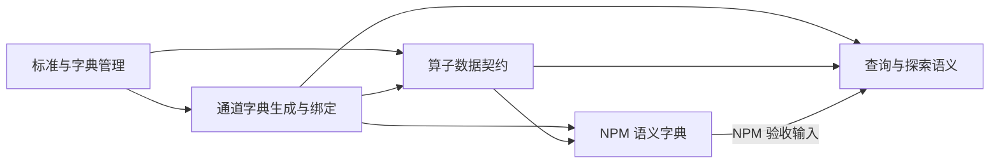

# Epic：数据标准与数据字典

状态：F1 标准与字典管理已完成并归档；F2～F5 待办。
本文件组织 Epic 的业务范围、能力归属、依赖和验收边界；不是单个 Feature 的实施规格。
各 Feature 立项时另建 `feat-<name>.md`，冻结 MVS、接口契约与 Feature Task；Atomic Slice 仍只进入工作台。
Epic 不增加任务编号层级，Backlog 只登记独立 Feature 目标，不按前后端、文件数或时间盒拆分。

## 业务意图与非目标

让 FlowSQL 的数据接入者、算子作者、查询与探索用户及程序调用方，能够一致理解和正确使用数据。
覆盖通道所承载的数据、算子输入输出和内置 NPM：自动取得结构事实，人工补充业务语义，定义可查询、可保存、可复用和可追溯。
数据标准规定共同定义与使用规则；数据字典解释具体实体和字段；算子契约说明输入要求、输出保证及转换关系。

- 本 Epic 不接入大模型，不实现 function calling 适配、MCP 服务、skills、提示词或诊断编排。
- 不建设企业级治理审批、全库扫描、自动根因推断、通用规则引擎或任意代码的语义推导。
- 不因登记标准而改写原数据，不把业务声明当成实际数据质量验证，不重新实现已有采集、算法或 Kafka 数据面。
- 不让通用算子依赖 NPM 专用字段；本轮仅拆分规划，不预先冻结全部实现文件、测试命令或部署矩阵。

## 共同数据契约与架构边界

| 对象 | 最小责任 |
| --- | --- |
| 数据标准 | 稳定身份、精确版本、业务概念、适用范围及表示规则；供字典引用 |
| 数据字典 | 实体身份、行粒度、身份/修订/关联键、字段结构与语义、标准引用、来源和未知状态 |
| 数据绑定 | 具体来源/数据集身份、实际结构标识、字典精确版本、字段映射和匹配状态 |
| 算子契约 | 算子版本、输入形态与字段角色、参数约束、固定或可推导输出、语义转换声明 |
| 使用依据 | 本次使用的对象/定义版本、已执行检查及未验证项；与实际数据证据分开 |

- 采用 JSON Schema Draft 2020-12 描述元数据文档、请求和响应；采用 OpenAPI 3.1 描述 HTTP 管理与查询接口。
  API 操作标识、错误和示例明确；各 Feature 同步扩展契约及其验证，不另设“AI 接入准备”Feature。
- JSON Schema 校验元数据文档，不替代 Arrow/数据库实际 Schema，也不证明业务声明或样本数据正确。
  单位、时间、行语义、身份/修订、关联、NULL、有效条件及聚合规则形成结构化属性，复杂解释保留文字。
- 区分未声明、不适用、声明来源和实际检查结果；不把字段名推测、结构匹配或保存成功当作语义已验证。
- 保存与应用分开：发布新定义不自动升级全部绑定，历史定义不覆盖；任务/结果引用当时解析的明确版本。
  旧结果没有引用时明确未知，不补造历史版本；结构相同也不能自动证明业务含义相同。
- Web、导入导出和 HTTP 使用同一模型与校验；JSON/YAML 作为输入输出形式，不维护互相漂移的说明副本。
  查询支持摘要、精确版本、字段选择、分页及截断标记；字段裁剪必须保留解释所需的实体和标准上下文。
- 复用现有配置资源的不可变版本、冲突检测和持久化能力，实施前评估适配边界，不先承诺另建一套存储。
  C++ 能力保持插件/IID 访问，跨进程控制面走 HTTP，原数据面继续使用已有通道；元数据读取不进入逐行/逐包热路径。
- 发布定义和绑定更新沿用调用者的权限与可见范围；普通程序可以验证接口，不以模型生成结果作为收敛标准。
- OpenAPI/JSON Schema 为后续适配提供基础，不宣称直接兼容所有 function calling 平台或已经符合 MCP 全部协议。

## Feature 拆分

### F1：标准与字典管理（data-semantics-registry）

已完成：[验收规格](../archive/feat-data-semantics-registry.md)、[使用说明](../../docs/data-semantics.md)。

**价值：** 数据维护者和程序调用方可集中维护、搜索和复用定义，获得重启后可读取、版本不漂移的统一事实来源。
**依赖：** 无本 Epic 内前置 Feature；复用既有配置、路由和 Web 基础。

- 交付通用标准、实体/字段字典、版本引用和数据绑定记录的模型、校验、持久化及 HTTP 契约。
- 交付独立管理入口：搜索、实体/字段详情、人工补充、标准关联、导入导出、保存、历史及引用对象查看。
- 结构事实与可编辑语义分离；保存新版本与应用到指定对象分离；共享定义的编辑展示影响范围。
- 定义版本由系统管理；未补全的定义允许保存并标记缺口；并发冲突保留编辑内容，历史恢复创建新版本。
- 以人工登记或导入的数据对象完成闭环，不承担通道结构发现、算子上传接线或领域字典内容生产。

**独立验收：** 标准和字典从创建、查询、编辑、保存到重启恢复可用；历史读取、引用、无变化提交、冲突和保存失败行为明确。
Web 与普通 HTTP 客户端取得同一内容；请求/响应及导入导出符合声明的 JSON Schema / OpenAPI，缺失语义可识别。

### F2：通道数据字典生成与绑定（channel-data-dictionary）

**价值：** 数据接入者从已有字段配置或实际结构获得可补充的默认字典，结构变化后仍能保留说明并知道哪些定义需要重新确认。
**依赖：** F1。

- 覆盖 Kafka 结构化 source 字段配置、CSV 导入/命名 DataFrame，以及已有数据库连接中的明确表对象。
  数据库绑定到表/数据集而非整个连接；首期覆盖已支持的 SQLite、MySQL、PostgreSQL、ClickHouse 表结构入口。
- 在接入/详情流程中生成默认字典或选择已有定义，记录字段映射、来源和精确版本；不能从结构确定的语义保持未知。
- DataFrame 未加载时允许结构待定，取得真实结构后再生成/核对，不因列表查询破坏现有懒加载保证。
- 交付对象内字段详情及补充入口；新增、删除、类型变化和可能重命名展示差异，保留人工说明并确认映射。
- 同名数据替换重新核对身份及语义绑定；仅登记元数据，不消费 Kafka 消息来猜含义、不改 Topic/表数据或强制单位转换。

**独立验收：** 各声明入口可自动生成默认定义、人工补充、保存和重读；结构更新、同名替换、未知信息及复用映射行为可验证。
覆盖 Kafka 字段配置、真实 CSV/DataFrame 和四类表结构路径；依赖按实际测试位置冻结，不以外部连接可达代替结构检查。

### F3：算子输入输出契约（operator-data-contract）

**价值：** 算子作者可一次声明可复用的数据要求，使用者可检查输入和解释输出，处理中间结果不会无依据地继承旧含义。
**依赖：** F1；F2 提供实际接入数据集与输出绑定链路。

- 支持内置与扩展算子的契约登记及现有 C++/Python 注册、创建、上传流程；随组件携带或引用已有定义。
- 描述输入形态、单/多输入、字段角色、类型与语义要求、参数影响，以及固定、多实体或配置决定的输出。
- 在算子详情显示输入/输出契约；调用时绑定实际字段，校验已支持的明确条件，未声明或不可判断项不伪装成兼容。
- 对已声明的原样复制、投影/重命名、单位转换和聚合规则生成具体输出定义，记录输入及算子版本。
  只对现有或验收夹具中明确支持的转换作保证；任意自定义代码或未知转换保留未知，不自动继承错误语义。
- 契约定义不直接改变算法；未携带契约的既有算子如实显示缺失信息，不因元数据不完整统一禁用既有执行。
  字段身份、标准引用和输出绑定复用 F1/F2，NPM 具体业务内容交给 F4。

**独立验收：** 注册/上传后可查询契约；非 NPM 数据能完成字段角色绑定、兼容/不兼容/未确定判定和结果字典生成。
实际输出与声明结构核对，已支持的保持、转换、聚合及未知路径有断言；任务/结果保留精确引用且新版本不改写历史。

### F4：NPM 标准与语义字典（npm-data-semantics）

**价值：** NPM 使用者可以通过公共机制获得与实现一致的业务解释，避免把观测缺失当作成功、把累计修订直接相加或错误关联实体。
**依赖：** F1、F2、F3；领域内容作为公共机制的使用者交付，不向通用模型添加 NPM 专用分支。

- 以现有 NPM Schema、字段字典、生产代码和测试为依据，覆盖 Basic、Session、DNS、HTTP1、TLS、ICMP 的 IPv4/IPv6 实体。
- 注册身份/方向、单位/时间、NULL/有效性、累计/增量、修订/聚合规则、关联键及观测局限；共享标准复用，差异保留。
- 关联算子多实体输出、托管数据及 history/latest/final 关系，说明附加字段、运行和来源引用及可关联范围。
- 核验既有数据声明的正确性，不新增协议指标、修改分析算法、重构 Baseliner 或把历史结果一律绑定到最新字典。

**独立验收：** 十二个实体的实际字段、类型、可空性和版本与字典一致，公共查询能准确定位关系及定义。
关键断言覆盖累计/增量、NULL、方向、时间口径、修订去重、运行关联及不完整观测；不得仅以文档条目存在判定语义通过。

### F5：查询与探索中的数据语义（data-semantics-consumption）

**价值：** 查询、绘图和外部程序的使用者在消费数据时获得实际适用的定义，能够识别单位、无效值及统计限制，并追溯依据。
**依赖：** F1、F2、F3；非 NPM 主链路可独立建设，完整验收使用 F4 的 NPM 语义包。

- 在查询结果、探索字段和图表配置中显示字段含义、单位、NULL/有效条件和统计规则，并链接到同一份字典详情。
- 单位展示与实际转换明确区分；声明规则可判定时提供适用性提示/检查，未知条件不自动补造过滤、聚合或转换表达式。
- 对支持的查询投影、别名和聚合记录结果与来源的语义关系；无法解析的任意 SQL 表达式明确未知，不承诺通用推导。
- 按使用场景完善摘要、字段选择、必要上下文和分页查询，保留对象/定义版本及检查范围，支持普通脚本消费。
- 查询字典不等于读取业务数据；沿用已有数据查询入口和权限，不新增大模型查询执行器或诊断工具。

**独立验收：** 非 NPM Kafka/CSV→DataFrame→已声明算子结果与 NPM 结果均能在消费入口查得一致定义。
字段裁剪不遗漏累计/修订等必要上下文；缺失信息、结构变化、版本更新与历史结果追溯行为明确。
普通 HTTP 客户端依据 OpenAPI 完成发现→取得绑定版本→读取语义/限制的流程，前端所见与接口内容一致，无模型依赖。

## 依赖与推进顺序

建议实施顺序为 F1 → F2 → F3 → F4 → F5，逐项验收、WIP=1；这是能力依赖，不是并行实施授权。
F1 可独立维护用户定义，F2 可独立改善接入，F3 可服务自定义算子，F4 可作为领域包复用，F5 交付消费侧正确使用保证。
接口和页面随所属能力交付；自动生成属于 F2/F3，NPM 内容属于 F4，共用编辑保存属于 F1，消费入口属于 F5。
后续 `llm-skill-diagnosis` 使用这些交付及已有 SQL 指引；本 Epic 不以任何模型、MCP 或 skills 实测作为完成条件。

## 范围覆盖与 Epic 完成条件

| 讨论结论 | 责任 Feature |
| --- | --- |
| 标准/字典独立维护、搜索展示、人工补充、保存历史与引用 | F1 |
| Kafka/DataFrame/数据库表从字段生成默认字典、绑定及结构同步 | F2 |
| 内置/扩展算子输入输出声明、上传登记、字段角色与语义传递 | F3 |
| NPM 已交付实体的可核验语义与托管结果关联 | F4 |
| 查询/图表就地使用、外部程序按需读取与历史依据 | F5 |
| JSON Schema、OpenAPI、精确版本、未知状态和接口测试 | F1 建立，F2～F5 持续遵守 |

- 五个 Feature 各自完成规格声明的验收；逐项记录选中、执行、通过及失败/跳过/未执行，不以演示代替检查。
- 验证两条完整主链路：外部数据接入→默认字典→补充保存→算子结果→查询/探索；NPM 内置定义→实际结果→消费和追溯。
- 每条链路证明 Web 与 HTTP 使用同一份定义，结构事实与人工语义不混淆，更新不覆盖人工补充或改变历史引用。
- 每个 Feature 立项时按改动冻结具体测试和依赖；本 Epic 不预设产品全量、镜像或所有外部认证矩阵。
- 所有子项完成后再标记 Epic 完成；当前仅 F1 完成，F2～F5 未实施，Epic 保持未完成。

## 依据

- [产品需求池](../product_backlog.md)、[现有配置通道](../archive/feat-config-channel.md)、[NPM 字段字典](../../docs/npm.md)。
- [JSON Schema Draft 2020-12](https://json-schema.org/draft/2020-12/json-schema-core.html)。
- [OpenAPI 3.1.1](https://spec.openapis.org/oas/v3.1.1.html)；后续模型平台的 Schema 子集和协议适配单独验证。
