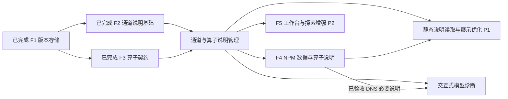

# Epic：数据说明与算子调用基础

状态：F1～F4、对象说明管理及三项通道/算子说明精简 Feature 已完成；F4 的 T1～T7 于2026-11-03全部验收并归档，包含已有受管对象的静态说明及独立真实运行依据；静态说明读取与展示优化于2026-11-20完成T1～T5并归档；F5 未实施。
保留 `data-semantics-dictionary` 标识、文件路径及 F1～F5 编号；本文件组织责任和依赖，不是一个待一次性实现的超大 Feature。
F1～F3 下文保留其已验收的历史交付事实；其独立管理页面的入口调整由 [通道与算子说明管理](../archive/feat-metadata-description-query.md) 承担，不重写已完成验收。
该 Feature 同时承担旧行内字典入口迁移、受影响表格布局恢复及原管理/预览操作回归；移除导航不等于完成入口调整，浏览器必须验证实际可见、可点击及说明读取无业务行副作用。

## 业务意图与非目标

用户在具体通道实例上查看和补充数据说明，在具体算子上理解输入、参数、输出、示例与限制；未来模型从相同接口发现对象并正确调用已有执行能力。
普通用户只需打开对象、补充必要说明并保存，不应先建立标准库、手工新建字典/绑定或填写内部身份。

- 产品目标收敛为可查询、可配置、可由普通程序读取的对象说明；不继续建设独立标准数据字典产品或企业治理平台。
- 标准、字典、绑定和版本存储作为内部能力复用；来源、组件版本和未知状态仍是可靠调用的必要依据。初始构建阶段不为当前代码或旧数据格式承担兼容和迁移责任。
- 说明读取不执行算法、不消费 Kafka、不扫描业务行、不隐式加载 CSV；预检和业务执行走已有入口。
- 不把人工说明当作真实数据质量证明，不自动推测单位/语义、不修改算法或增加 NPM 指标。
- 模型工具适配、skills 与诊断编排归 `llm-skill-diagnosis`；本 Epic 的基础接口由普通 HTTP 验证，不以真实模型运行作为验收条件。

## 最小责任与既有能力复用

| 内容 | 对用户/程序的责任 | 内部依据 |
| --- | --- | --- |
| 通道数据说明 | 展示真实字段并补充含义、单位、NULL、一行含义及必要时间/关联规则；数据库定位具体表 | F2 来源身份/结构与 F1 精确字典/绑定 |
| 算子说明与契约 | 展示用途、输入、参数、输出、示例和限制；补充文字与执行声明分别标明来源 | F3 组件关联契约；本地补充按组件版本保存 |
| 结果依据 | 保留结果实际使用的定义与组件信息，历史无记录时明确未知 | F3 使用依据与结果绑定 |
| 标准/版本/绑定 | 用户不必创建标准或手工绑定；系统处理对象内保存和关联 | 复用已实现机制，不再暴露为常规独立新建流程 |

- JSON Schema/OpenAPI、对象身份、精确引用与必要上下文继续复用；不另做一份给模型的元数据或新存储引擎。
- 对象查询优先返回结构与说明，结构已知而未绑定仍返回字段；pending、说明缺失、结构冲突与服务不可用分别表达，空缺不冒充验证通过。
- 对象内一次保存封装既有定义保存与应用；若只有定义保存成功，必须如实报告部分成功并保留原稿，不能伪装为已应用。
- 描述接口与目录同步只读；保存、预检和执行都是明确的独立操作。控制面使用 HTTP/IID，元数据不进入逐行/逐包路径。
- 通用管理与精确版本读取按目标契约提供，新流程不依赖主导航“标准与字典”，不要求新用户建立标准；当前 API/ABI 无兼容承诺，必要调整同步调用方、Schema、测试与文档，不增加旧入口适配或双轨实现。

## Feature 拆分

### F1：标准与字典管理（data-semantics-registry）

已完成：[验收规格](../archive/feat-data-semantics-registry.md)、[使用说明](../../docs/data-semantics.md)。

**价值：** 数据维护者和程序调用方可集中维护、搜索和复用定义，获得重启后可读取、版本不漂移的统一事实来源。
**依赖：** 无本 Epic 内前置 Feature；复用既有配置、路由和 Web 基础。

- 交付通用标准、实体/字段字典、版本引用和数据绑定记录的模型、校验、持久化及 HTTP 契约。
- 交付独立管理入口：搜索、实体/字段详情、人工补充、标准关联、导入导出、保存、历史及引用对象查看。
- 结构事实与可编辑语义分离；保存新版本与应用到指定对象分离；共享定义的编辑展示影响范围。
- 定义版本由系统管理；未补全的定义允许保存并标记缺口；并发冲突保留编辑内容，历史恢复创建新版本。
- 以人工登记或导入的数据对象完成闭环，不承担通道结构发现、算子上传接线或领域字典内容生产。

**独立验收：** 标准和字典从创建、查询、编辑、保存到重启恢复可用；历史读取、引用、无变化提交、冲突和保存失败行为明确。
Web 与普通 HTTP 客户端取得同一内容；请求/响应及导入导出符合声明的 JSON Schema / OpenAPI，缺失语义可识别。

### F2：通道数据字典生成与绑定（channel-data-dictionary）

已完成：[验收规格](../archive/feat-channel-data-dictionary.md)。

**价值：** 数据接入者从已有字段配置或实际结构获得可补充的默认字典，结构变化后仍能保留说明并知道哪些定义需要重新确认。
**依赖：** F1。

- 覆盖 Kafka 结构化 source 字段配置、CSV 导入/命名 DataFrame，以及已有数据库连接中的明确表对象。
  数据库绑定到表/数据集而非整个连接；首期覆盖已支持的 SQLite、MySQL、PostgreSQL、ClickHouse 表结构入口。
- 在接入/详情流程中生成默认字典或选择已有定义，记录字段映射、来源和精确版本；不能从结构确定的语义保持未知。
- DataFrame 未加载时允许结构待定，取得真实结构后再生成/核对，不因列表查询破坏现有懒加载保证。
- 交付对象内字段详情及补充入口；新增、删除、类型变化和可能重命名展示差异，保留人工说明并确认映射。
- 同名数据替换重新核对身份及语义绑定；仅登记元数据，不消费 Kafka 消息来猜含义、不改 Topic/表数据或强制单位转换。

**独立验收：** 各声明入口可自动生成默认定义、人工补充、保存和重读；结构更新、同名替换、未知信息及复用映射行为可验证。
覆盖 Kafka 字段配置、真实 CSV/DataFrame 和四类表结构路径；依赖按实际测试位置冻结，不以外部连接可达代替结构检查。

### F3：算子输入输出契约（operator-data-contract）

已完成：[验收规格](../archive/feat-operator-data-contract.md)。

**价值：** 算子作者可一次声明可复用的数据要求，使用者可检查输入和解释输出，处理中间结果不会无依据地继承旧含义。
**依赖：** F1；F2 提供实际接入数据集与输出绑定链路。

- 支持内置与扩展算子的契约登记及现有 C++/Python 注册、创建、上传流程；随组件携带或引用已有定义。
- 描述输入形态、单/多输入、字段角色、类型与语义要求、参数影响，以及固定、多实体或配置决定的输出。
- 在算子详情显示输入/输出契约；调用时绑定实际字段，校验已支持的明确条件，未声明或不可判断项不伪装成兼容。
- 对已声明的原样复制、投影/重命名、单位转换和聚合规则生成具体输出定义，记录输入及算子版本。
  只对现有或验收夹具中明确支持的转换作保证；任意自定义代码或未知转换保留未知，不自动继承错误语义。
- 契约定义不直接改变算法；未携带契约的既有算子如实显示缺失信息，不因元数据不完整统一禁用既有执行。
  字段身份、标准引用和输出绑定复用 F1/F2，NPM 具体业务内容交给 F4。

**独立验收：** 注册/上传后可查询契约；非 NPM 数据能完成字段角色绑定、兼容/不兼容/未确定判定和结果字典生成。
实际输出与声明结构核对，已支持的保持、转换、聚合及未知路径有断言；任务/结果保留精确引用且新版本不改写历史。

### F4：NPM 数据与算子说明（npm-data-semantics）

**价值：** NPM 查询用户和未来诊断程序可解释现有结果并调用已有算子，避免把未观测当成功、累计修订重复相加或错误关联实体。
**依赖：** F1～F3、对象说明管理及三项说明精简 Feature；继承已交付 npm.basic 作者契约，生产领域内容及有限结果接入，不重建公共机制。
T1～T7 已验收：[归档](../archive/feat-npm-data-semantics.md)；十二实体358分析字段、37个运行关联对象、50个既有受管对象的静态字典、同源配置、精确运行依据及既有页面形成闭环，支持SQLite/MySQL/PostgreSQL/ClickHouse及通用结构提供者扩展；读取静态说明无需新分析任务。

- 冻结 Basic、Session、DNS、HTTP1、TLS、ICMP 共十二个既有 IPv4/IPv6 实体；生产结构同源，补齐字段/实体含义和必要调用说明，不重复交付既有契约。
- 生产闭环为有限 PCAP/PCAPNG→npm.basic→SQLite/MySQL/PostgreSQL/ClickHouse 托管 history/latest/final 关系→对象说明；包含必要运行上下文和精确依据，不纳入实时、容器矩阵、独立 DataFrame 输出或任意 SQL 来源传播。
- DNS 必要上下文和真实闭环先作为独立阶段验收，其余实体随后沿同一路径完成；最终统一验收包含全部十二实体及受影响的共享契约回归。
- 优先复用公共字典/契约、IID/HTTP 和页面，接入 NPM 配置适配及有限发布/绑定；不要求兼容当前代码，必要契约调整在实施前冻结并同步调用方，不建设第二套语义系统、规则语言或专用配置页。
- 默认领域说明由产品提供；人工补充、共享关系说明与运行特有参数/版本分别保存，不补造历史关联，不将描述性有效/聚合条件升级为自动去重、JOIN 或数据质量验证。

**独立验收：** 每阶段选中实体的字段、类型、可空性和版本与真实结果一致；关键时间、有效性、累计修订和关联规则有断言。
DNS 阶段须证明程序能经对象接口取得完整的诊断必要上下文并解释代表结果；模型诊断可使用该已验收阶段，不等待其余实体全部完成。
T1～T5 阶段已验收十二实体、有限 PCAP/PCAPNG→SQLite 接入、HTTP/IID/既有页面、人工补充与精确历史及实际重启；最终 integration 24/24（12功能+12夹具）、unit 4/4，失败/跳过/未执行均零。T6 已完成三生产后端真实报文、原生结构/NULL、精确关联、人工补充、HTTP/PCAPNG/重启及扩展类型断言；最终 integration 24/24（12功能+12夹具）、unit 4/4，失败/跳过/未执行均零，源码和产物一致。保留原阶段证据；范围外部署仍未验收，Epic 的 F5 保持独立待办。

### 静态说明读取与展示优化（data-semantics-read-optimization）

状态：`[x]` 已完成；**优先级：** P1；[归档规格](../archive/feat-data-semantics-read-optimization.md)。保留 F1～F5 编号，本 Feature 承接已交付基础链路的性能与页面优化，不重开历史验收。
**价值：** 频繁阅读说明的用户、任务执行器和未来模型调用方，能快速读取静态定义，并在通用页面找到全部已声明字段、参数、条件和关联，减少等待与误用。
**依赖：** F1～F4、对象说明管理及现有通道/算子说明组件；静态读取、任务准备及通用页面/下载已交付。

- 标准、字典与作者契约按精确不可变版本复用已校验内容及必要投影，小摘要不重复读取/解析 MB 级全文；保留字节有界、并发安全、历史和插件/存储生命周期保证。
- 动态组件、current/绑定和真实结构仍按权威来源核验；拆分测量静态读取、元数据准备与分析数据面，不把任务总耗时当作语义开销，不以减少校验或增加超时提速。
- 统一“摘要→字段表→分组详情→原始 JSON”的对象内阅读，作者短说明不替代结构声明，补齐字典实体/字段语义位置、复杂输出入口及多尺寸布局；提供直接 JSON 下载并保留人工编辑和历史。
- 不交付 DESC/结果/图表说明、模型工具或新语义规则语言；与 F5 及 `llm-skill-diagnosis` 分别验收，复用同一接口与领域内容。

**独立验收：** 静态热读无重复定义正文查询/全文解析/摘要计算，IID p95≤1ms、小响应 HTTP p95≤100ms，重复任务语义准备中位耗时下降至少70%，以同环境基线核对；完整条件见独立规格。
真实 Chromium 验证 NPM/Baseliner/普通算子与通道的字段覆盖、对齐、草稿和历史，局部/全文及下载与精确 HTTP 内容一致；按受影响共享契约回归，不默认全产品或外部后端矩阵。
完成证据：最终定向回归39/39、三类真实浏览器及夹具通过；完整性能对照的重复准备下降73.04%，离线/受控实时吞吐为基线100.37%/100.70%，详见归档规格及当前用户说明。

### F5：工作台与探索中的说明增强（data-semantics-consumption）

**价值：** 频繁编写 SQL、查询和绘图的用户可以就地查阅已有说明，减少切换页面和误用统计口径。
**优先级：** P2；**依赖：** 对象说明与已实现语义基础；选择 NPM 场景时只依赖相应已验收说明，不是模型接入的前置条件。

- SQL 工作台提供服务端解析的单条 `DESC CHANNEL <实例/限定表>`、`DESC OPERATOR <category.name>`，同步复用 describe，不创建执行任务；不支持与 SELECT 混合或多条 DESC。
- DESC 结果复用通道/算子详情展示，不塞入普通 rows/columns 表格；对象页始终是主要入口，不因增加快捷命令重建独立管理工作台。
- 在查询结果、探索字段和图表配置中按需显示已有说明、单位、NULL/有效性和聚合限制，并导航到实际对象/结果版本。
- 只对明确支持的投影、别名和聚合记录来源关系；任意表达式保持未知，不扩展为通用 SQL 语义推理、自动转换或自动补造过滤。
- 立项按具体体验场景冻结范围，不把所有图表、完整引用关系浏览及全部 NPM 内容捆绑为前置；基础 HTTP 发现/描述与对象维护已由对象说明 Feature 交付。

**独立验收：** DESC 与对象接口内容一致、无任务或隐式数据读取；普通 SQL 分类/执行不受影响。
选中结果/探索场景显示正确版本和必要上下文，对未解析表达式如实表达未知；不以真实模型诊断通过作为本 Feature 的完成条件。

## 依赖与推进顺序

对象说明管理及 F4 全部实体已验收，DNS 必要说明已具备后续模型诊断的数据前提；静态说明读取与展示优化也已验收，模型诊断与 F5 仍需独立授权。
阶段交接只在当前 Task 完整验收、工作台 WIP=0 后由后续任务授权/工作台边界决定，不是并行实施或跳过未完成验收的授权。
`llm-skill-diagnosis` 负责模型/Skills 工具适配与“发现→描述→按需预检→受控查询→解释”，不要求用户创建标准/字典/绑定，不等待整个 Epic 完成。
对象说明 Feature 保留 `metadata-description-query` 标识；其新规格覆盖查看/配置，原 DESC 主入口设计已迁至 F5，没有遗留同名只读实施任务。

## 范围覆盖与完成条件

| 交付 | 责任 |
| --- | --- |
| 已有版本、精确引用、通道结构与算子执行契约 | F1～F3 已完成，保留验收历史 |
| 移除独立主导航、迁移旧行内入口并恢复表格显示、通道内说明配置、算子内契约/补充说明、共享对象描述 API | metadata-description-query |
| NPM 真实字段/输出/调用说明，优先 DNS 必要上下文 | F4 |
| 静态标准/字典/契约读取性能、任务语义准备开销及现有对象页完整分层展示/JSON 下载 | data-semantics-read-optimization |
| DESC、查询结果/探索字段/图表中的就地说明 | F5，P2 |
| 模型适配、Skills、受控调用与诊断证据组织 | 独立 llm-skill-diagnosis |

- 基础对象接口的交付允许模型适配开始，不意味着整个 Epic 或全部领域说明已经完成；各 Feature/Task 保持独立状态与验收依据。
- 仍需证明前端与 HTTP 同源、结构事实与人工补充可辨、更新不改变历史、组件/来源变化不串用说明。
- 最终 Epic 完成须包括声明范围中的对象说明、F4、静态说明读取与展示优化及 F5；各 Feature 按影响冻结测试，必需用例无失败/跳过/未执行，不默认全产品或全外部矩阵。
- 首期不把“标准库条目完整”“所有可选语义均填写”或实际接入模型作为基础对象说明的完成门槛。

## 依据

- [产品需求池](../product_backlog.md)、[对象说明规格](../archive/feat-metadata-description-query.md)、[现有配置资源](../archive/feat-config-channel.md)、[NPM 使用说明](../../docs/npm.md)。
- 复用 [JSON Schema Draft 2020-12](https://json-schema.org/draft/2020-12/json-schema-core.html) 与 [OpenAPI 3.1.1](https://spec.openapis.org/oas/v3.1.1.html)；特定模型平台协议适配由后续模型 Feature 验证。
