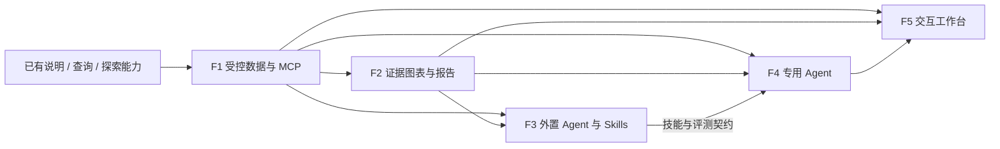

# Epic：大模型与 Skills 交互式异常诊断（llm-skill-diagnosis）

状态：2026-11-27 F1 已完成并归档；F2～F5 为 `[ ]` 待实施，其接口与技术选型在各自 T1 验证冻结。
原单一 Feature 标识保留为 Epic，只组织独立 Feature 的价值、责任、依赖和整体完成条件，不作为第六个实施 Feature。
依据：[完整分析报告](../../docs/archive/2026-11-25-llm-skill-diagnosis-analysis.md)、[产品需求池](../product_backlog.md)。

## 业务意图与 Non-Goals

让网络分析用户从独立诊断入口或当前数据探索范围出发，通过外置通用 Agent 或独立部署的专用 Agent 连续调查异常，
获得可追溯的表格、交互图表、事实与候选原因，并保存为可重读的诊断报告及 Markdown/PDF。

- F2～F5 子规格仍是规划草案，不能当作已实现或验收证据；F1 的当前契约和真实验收见其归档规格。
- 不包含自动修复、业务配置自动修改、任意代码宿主执行、原始报文回溯或无证据根因承诺。
- 不重建数据字典、通用 BI、企业知识库或全平台权限体系；复用既有说明、执行与探索能力，补齐实际接入边界。
- DNS 是首条真实业务验收链路，不能据此删除双入口、独立部署、外置接入、表图交互或报告保存要求。
- 不承诺全部模型、MCP 宿主、协议分析及部署矩阵；各 Feature 在实施前冻结实际支持范围，并对范围内能力完整验收。
- 不保留旧实现兼容层或自有版本别名；外部协议按其真实规范使用，产物修订与来源身份用于追溯。

## 拆分依据

五项能力具有不同使用者、运行主链路和可独立复用的产物；不按前后端、代码文件数或实施时长拆分。

| Feature | 使用者与独立价值 | 可独立验收的结果 | 状态 |
| --- | --- | --- | --- |
| F1 [受控数据与 MCP 接入](../archive/feat-agent-data-access.md) | 程序与任意已接入 Agent 按各类通道的实际能力和授权范围使用 FlowSQL 数据，跨业务复用 | 普通客户端完成发现、描述、按需预检、执行、取消和结果读取；非 NPM 场景及独立 MCP 服务可验收，无模型依赖 | `[x]` |
| F2 [诊断证据、图表与报告](feat-diagnosis-artifacts.md) | 分析者和程序可留存、阅读与分享稳定的分析产物 | 无 Agent 时也可保存证据、渲染表图文字、重启重读和导出 Markdown/PDF | `[ ]` |
| F3 [外置 Agent 诊断与 Skills](feat-diagnosis-skills.md) | 使用通用 Agent 的网络分析用户可直接复用领域方法完成调查 | 声明支持的真实外置宿主完成 DNS 诊断、表图阅读、追问及报告保存 | `[ ]` |
| F4 [独立部署的专用诊断 Agent](feat-diagnosis-agent.md) | 部署者与产品客户端可运行自有、可观察且可继续的诊断服务 | 独立进程通过会话接口完成调查、交互中断、恢复及证据关联，无工作台依赖 | `[ ]` |
| F5 [交互诊断工作台与探索联动](feat-diagnosis-workspace.md) | FlowSQL 用户可在统一产品体验中从问题或异常图形开展连续调查 | 独立入口与探索入口共用会话，表图选择能驱动追问，报告可编辑保存导出 | `[ ]` |

## 整体检视结论与实施边界

五个 Feature 分别交付接入、产物、领域方法、调查服务和产品交互，价值与责任可独立验收，保留现有拆分。
现有说明、查询和探索可复用；以下缺口必须由所属 Feature 补齐，不能因已有 HTTP 接口或候选 SDK 就认定已经具备。

| 检视发现 | 刷新后的责任与可观察结果 |
| --- | --- |
| 受控身份和结果跨服务交接未落到执行契约 | F1 交付真实主体/委托校验、查询子集与不可变结果读取/租约；F2 校验并持久转存，不能信任模型或浏览器提供的数据事实 |
| 重启后“继续且不重复”缺少上下游依据 | F1/F2 提供稳定请求身份、去重、持久操作状态；F4 先记请求再调用并核对未知状态，不要求恢复任意底层任务 |
| 历史报告、图形选择与产物权限未完整衔接 | F2 负责保存修订、证据/选区/附件权限及完整导出；F3/F5 只做交互适配，历史读取不重新查源库 |
| 普通外置宿主没有网页自动回传保证 | F3 验收选区引用与可复制追问文本的标准路径，并单独验收真实 MCP Apps 双向交互；页面链接不替代 Apps 验收 |
| 探索入口与证据回到探索尚非现成功能 | F1 补公开关系；F5 补来源映射、受限工作流转换、可信结果交接和证据快照回到探索，不丢弃不支持条件 |
| 技术选型与验收存在隐含耦合 | F1 优先验证 Python 协议层；F4 原型只比较关键能力，产品完整评测只跑最终方案；F4 依赖 F3 技能/评测契约，不依赖 Apps 适配 |

代码核查依据：[探索目录排除视图及结果处理](../../src/services/visualization/exploration_service.cpp)、[有界只读查询接口](../../src/framework/interfaces/idatabase_exploration.h)、[当前嵌入桥接](../../src/frontend/src/components/ExplorationFrame.vue)。
本次是契约完整性和实施路径检视，未验证数据库权限、真实宿主、模型质量、部署性能或故障恢复。

## 最小共享契约与责任

以下仅划分核心数据的含义与唯一责任方；公开 Schema、接口及测试断言由对应 Feature 在编码前输出并冻结。
后续调用方直接复用同一契约，必要调整同步所有调用方；不各自建立同名但不同含义的模型。

| 数据或接口 | 唯一责任 | 核心表达 |
| --- | --- | --- |
| `AccessScope` / `SourceRef` | F1 | 服务端认定的主体与允许操作、对象、时间和预算；真实来源、结构及运行/快照身份 |
| `SourceCapabilities` / `OperationDescriptor` | F1 | 通道/配置资源的数据形态、角色、实际支持的操作及限制；复用领域说明，不把可发现等同于可查询或获准执行 |
| `QueryRequest` / `QueryResult` | F1 | 有界查询或明确授权的分析执行、任务状态、结果数据和实际计算/说明依据；不冒充永久报告 |
| `ResultRef` / `OperationStatus` | F1 | 主体范围内的不可变结果与读取寿命、稳定请求/任务关联、取消及待核对状态；供 F2 转存和 F4 恢复核对 |
| `AnalysisContext` / `Evidence` | F2 | 问题与范围、来源引用；保存后的结果、查询口径、说明依据、完整性和时间 |
| `DisplayBlock` / `Finding` / `Report` | F2 | 表格、图表、事实/解释及证据引用；固定报告修订、人工修改来源及可导出内容 |
| `Selection` / `ArtifactOperation` | F2 | 绑定证据/上下文修订的字段与范围选择；保存/导出的幂等请求、状态及授权结果引用 |
| `SkillPackage` / `DiagnosisCase` | F3 | 领域调查方法与依赖；固定输入、预期事实、反证和真实模型评测记录 |
| `DiagnosisSession` / `DiagnosisEvent` | F4 | 调查状态、消息与工具操作、待输入事项、预算和 F2 产物引用；前端事件协议 |
| `ExplorationHandoff` | F5 | 当前来源、过滤、时间、字段、图表与选区，转换为 F2 上下文并由 F1 重新验证权限 |

- F1 拥有 MCP 数据工具及接入基础；F2 拥有产物读写/导出工具，两者共用接入与授权机制，外置模式不依赖 F4。
- F1 提供同一 MCP 服务的显式模块注册；F2 注册产物/选区工具，F3 注册 Apps 资源及桥接。模块未部署时不暴露可用能力，F1 基础接入不依赖后续模块。
- F1 的数据契约覆盖 Database、DataFrame、结构化流、块流和 Config 的不同角色；本期操作矩阵以 F1 为准，NPM/DNS 不限定通用工具的来源与字段。
- F2 拥有图表渲染组件和只读报告入口；F3 适配 MCP Apps 宿主；F5 复用组件实现交互工作台，不重复计算指标或复制报告存储。
- F1 提供已声明指标的确定性计算；F3 定义业务有效条件并评测；F4 选择调查步骤，不能由模型编造数字。
- F4 持久化会话及执行状态，证据和报告仍引用 F2；检查点不等于外部操作恰好执行一次。
- 同一主体身份贯穿 F1/F2/F4；F1 校验来源与操作，F2 校验产物/附件，F4 校验会话。来源或选区引用不授予权限，普通浏览器与 MCP 不能绕行原始执行入口；本期不新增匿名分享或通用用户/协作管理平台。
- F1 先交付最低 DNS 数值口径及隔离 fixture；F3 在其上定义问题、反证和质量门槛，F4 复用，F5 验证交互闭环。新增指标先补 F1 契约/独立数值测试，避免 F1 等待尚未交付的 F3 才能验收。
- 数据和说明的来源/修订复用现有系统；产品诊断产物进入产品存储，开发测试证据进入忽略的 `evidence/<feature>/`。

## 架构与选型边界

- 专用 Agent 无论从何处进入，始终独立进程或容器部署；拥有独立配置、模型凭证、健康检查与资源预算，不附着 Scheduler 或现有 Python Worker 生命周期。
- C++ 能力仍由统一框架加载 `.so`，本进程经 IID 暴露能力，跨进程使用 HTTP；批量数据继续使用既有数据面，模型仅接收有界结果和引用。
- MCP 用于 Agent 与工具；Agent Skills 用于方法分发；前端交互协议与图表/报告业务契约分别定义。
- F1 优先采用 Python 实现独立 MCP 协议适配层，在 T1 最小验证后冻结语言/SDK；经公开 HTTP 调用 FlowSQL C++ 服务/插件提供的通道、业务授权及任务/结果能力，数据处理沿用既有执行链路。MCP 独立打包、配置、测试和启停，不导入 Worker/Agent 内部模块或依赖本地 C++ 产物，不要求整个 Feature 使用 Python；真实数据闭环由 T4 验收。
- Deep Agents/LangGraph 是 F4 的优先验证候选，OpenAI Agents SDK 与 Pydantic AI 是重点对照；Claude Agent SDK、应用平台和直接模型 API 的取舍也须记录依据。
- AG-UI、Vega-Lite、Chromium/Playwright 分别是事件、图表和 PDF 的候选技术；最终依实际能力测试冻结，不把调研意见写成完成事实。
- Python MCP 或专用 Agent 如被选中，按各自规格明确为框架外服务及与 Python Worker 的职责边界，并在实施时同步架构说明；本轮不改变全仓架构规则。
- F2 后端沿用 C++ 插件框架，提供持久产物与受控渲染/导出入口；F5 交付可独立发布的静态工作台包和同包内嵌方式，均使用配置化服务地址与同一主体认证。F1/F4 最低交付独立包/进程，容器只在明确交付时验收。
- 不要求多 Agent、脚本沙箱、向量检索全部落地；以声明场景的必要性和实测结果决定，不能以缩减用户要求来代替选型。

## 两条主链路

1. **外置诊断**：通用宿主加载 F3 Skills → 经 F1 发现/描述并按范围查询 → F2 转存证据、渲染表图与结论 → 标准页面复制选区引用追问或 Apps 内嵌回传 → F1 按新上下文核验执行 → F2 保存及导出报告；全过程无需 F4/F5。
2. **内置体验**：F5 独立入口或经核验的探索上下文进入 F4 会话 → 复用 F3 方法并经 F1 调查 → F2 保存证据 → F5 按修订传回选区 → F4 继续验证 → F2 固定报告并导出；证据可作为只读快照返回探索，断连/重启按稳定身份核对。

## 依赖与建议推进顺序

默认仍按 F1 → F2 → F3 → F4 → F5 收口；若另行授权调整顺序，F4 只需 F3 已冻结的技能/评测交付，不必等待 Apps 适配，但 Epic 完成仍要求 F3 全部验收。依赖不自动授权实施或并行开工，保持 WIP=1。
F2 使用普通客户端验证，F3 使用外置宿主验证，F4 使用会话客户端验证，均无需等待 F5 的产品界面。
选型调研及小型原型是对应 Feature 的实施步骤，不另拆成只有技术动作、没有独立产品价值的 Feature。

| 阶段 | 开始实施所需输入 | 必须向后续交付的结果 |
| --- | --- | --- |
| F1 | 既有通道/执行接口、隔离数据、部署身份约束与可用身份来源 | 来源/操作 Schema、最低 DNS 数值 fixture、ResultRef 读取/租约、稳定操作身份和通用 MCP |
| F2 | F1 契约与真实有界结果 | 持久证据、报告修订、产物工具/权限、Selection 引用、渲染组件及两种完整导出 |
| F3 | F1 工具/指标、F2 产物、真实宿主/模型及费用预算 | 固定技能/评测包、标准页面与 Apps 两条实测路径及质量证据 |
| F4 | F1/F2 真实服务、F3 技能/评测契约、可用模型 | 主体隔离的会话/事件、单会话运行、持久化和操作核对、独立服务 |
| F5 | F1/F2/F4 服务、已有探索与共享 Selection | 独立/内嵌工作台、探索可信往返、编辑导出和完整用户闭环 |

各 T1 在编码前冻结共享契约及最低测试输入；原型可用 fixture 验证适配，Feature 完成必须使用声明的真实服务/宿主/模型。
后续消费发现契约缺口时，更新其唯一责任方及调用方，不复制第二套模型或默默放宽验收。

## 用户要求覆盖与相邻规划

| 要求或相邻能力 | 责任与边界 |
| --- | --- |
| 独立入口、数据探索入口 | F5；F2 的只读报告入口不替代完整工作台 |
| 诊断证据继续探索 | F2 提供受权证据读取；F5 适配有界只读探索快照，保留输入证据身份，不用当前源数据替换历史结果 |
| 外置通用 Agent、标准数据读写与方法 | F1/F2 提供接口，F3 完成真实宿主与 Skills 闭环 |
| 内置自研且独立部署、充分调研 | F4；自托管 Agent 与模型本地推理是不同部署决策 |
| 表格、折线、饼图、条形、直方图及恰当呈现 | F2 提供结构和渲染，F3/F4 选择表达，F5 接续图形交互 |
| 提示、事实、候选原因与验证建议 | F3 的诊断方法、F4 编排、F2/F5 呈现 |
| 保存结论、Markdown/PDF | F2 的稳定证据和报告，F3/F5 提供各自调用入口 |
| NPM 公开关系接入 | F1 补齐目录和受控读取；F5 保证探索入口与诊断来源映射，不以内部物理表替代公开语义 |
| 通用通道接入、Python MCP 独立性 | F1；各类通道统一描述并按能力开放操作，含非 NPM 验收；独立包/进程仅通过公开服务契约接入 FlowSQL |
| `exploration-workspace-persistence` | 继续负责通用探索方案持久化；F2 保存本次诊断证据，F5 只交接当前探索上下文，不以该长期 Feature 为前置 |
| `durable-task-lifecycle` | 继续负责采集/分析任务的数据连续性；F4 负责 Agent 会话状态及与既有任务核对，不承诺恢复任意底层任务 |
| 原始报文调查与其他协议诊断包 | 保留独立业务边界；当前不新增采集解析算法或包回溯 |

## 整体完成条件

- F1～F5 各自完成规格中的全部 Task 与冻结验收；真实外置和内置两条主链路均有可复核证据。
- 上表用户要求全部可用，不能用纯文字回答、模拟 Agent 或仅下载空报告替代产品能力。
- 测试包含真实 DNS 数据、错误归因反例、来源/范围保持、图形追问、服务重启、取消以及 Markdown/PDF 离线阅读。
- 真实模型评测与确定性契约/数值测试分别报告，模型、宿主、数据源及部署的未验证范围明确列出。
- 必需测试无环境跳过；各 Feature 按影响选择回归，独立部署测试只覆盖实际交付的部署契约，不默认仓库全量测试。
- 每个 Feature 将实际测试、fixture 和依赖接入统一测试配置/入口；模型/宿主不可用时报告未验证，不将模拟等价为通过。质量门槛在运行前冻结，确定性硬断言不以平均分掩盖；费用未知时不得记零。
- F1/F2 的响应丢失与幂等、F4 的真实进程重启、F5 的事件续读和上下文切换形成一条故障验收链；源码/产物、协议/模型/宿主身份及运行证据分别记录，已存报告在源库/Agent 不可用时仍可读。

## 完成证据

2026-11-26 完成整体规划检视并刷新五份 Feature、需求池及共享责任；保留五个 Feature、每项四个 Task 和两条业务主链路。文档校验记录位于未入库的 `evidence/llm-skill-diagnosis/epic-review/`；未运行原型、模型、构建或产品验收，全部实现状态保持待办。
